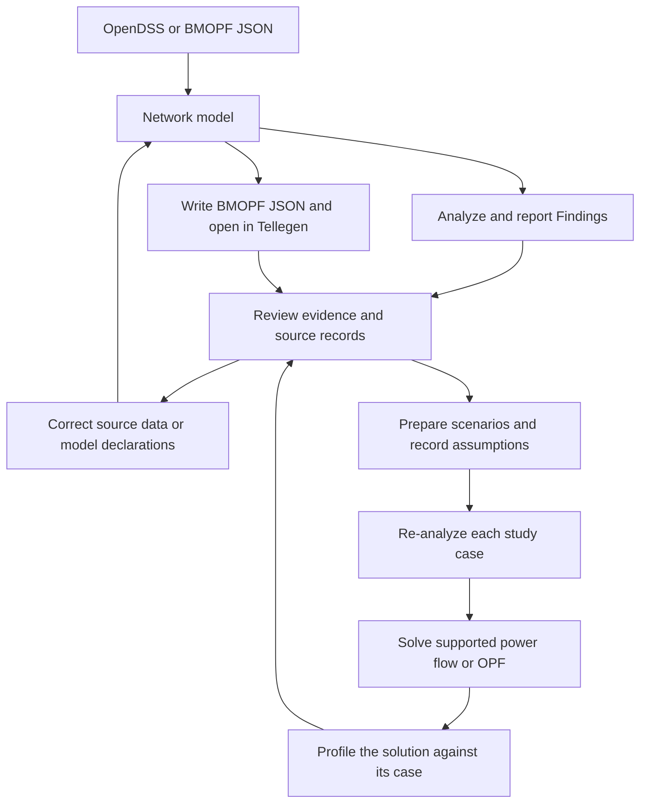

# BMOPFTools.jl

<p align="center">
  
</p>

**Inspect, prepare, and optimize unbalanced distribution networks.**

BMOPFTools is a Julia library connecting network-data diagnostics, geospatial
review, and multiconductor power-flow and optimal power flow (OPF) workflows.
Import OpenDSS or BMOPF cases, investigate modeling inconsistencies, prepare
study scenarios, and check the resulting solutions—with explicit assumptions
and traceable transformations.

[](https://frederikgeth.github.io/BMOPFTools.jl/) [](https://github.com/frederikgeth/BMOPFTools.jl/actions/workflows/ci.yml) [](https://codecov.io/gh/frederikgeth/BMOPFTools.jl)

[Documentation](https://frederikgeth.github.io/BMOPFTools.jl/) ·
[Quickstart](#quickstart) ·
[Visual inspection](docs/src/visualization.md) ·
[BMOPF specification](https://distribution-system-opt.github.io/math-and-data-model-specifications/)

> [!WARNING]
> The first registered release is being prepared. Development on `main` can
> include unreleased breaking changes; registered releases follow the
> [documented compatibility policy](docs/src/dev/versioning.md).

The package supports the IEEE PES Task Force on **Benchmarking Multiconductor
OPF for Distribution Systems** and its BMOPF JSON data model for up-to-four-wire
networks. See [Project and community](#project-and-community) for the team and
ways to contribute. Code is BSD-3-Clause; network data has separate,
[source-specific license terms](#licensing).

## Why BMOPFTools?

Before using a distribution model for a study, engineers need to understand
what it represents: which conductors and grounding conventions it uses, where
its parameters came from, whether its geometry agrees with its connections,
and which operating limits are known or assumed. Researchers need the same
information to reproduce a result and compare algorithms meaningfully.

BMOPFTools brings those questions into a repeatable workflow. It reports coded
Findings, preserves evidence about conversions and transformations, and checks
compatible solver results against the network model. A geographic discrepancy
can be investigated alongside the electrical declarations; study assumptions
can be recorded alongside the case they change.

Reliable benchmarks are also essential for validating and comparing power-system
algorithms. This repository contributes to the IEEE PES Task Force's effort to
provide a common, open benchmark format for unbalanced distribution networks,
motivated by community libraries such as [PGLib](https://power-grid-lib.github.io/).
Its checks support case preparation and review; they do not by themselves
certify physical fidelity, feasibility, or fitness for a particular study.

## What you can do

- **Inspect network models.** Convert OpenDSS with `from_dss`, or load BMOPF
  JSON with `parse_bmopf`. Check required fields, configuration and terminal
  rules, references, dimensions, domain plausibility, and redundancy. Analyze
  inventory, voltage levels, connectivity, diversity, operational loading,
  infeasibility preflight, and benchmark-readiness diagnostics.
- **Review geographic and electrical discrepancies together.** Use spatial
  diagnostics to investigate coordinate coverage, route endpoints, line lengths,
  and nearby or overlapping assets. Match the report's bus and branch IDs to
  the case in [Tellegen](https://tellegen.dev/), inspect the electrical context,
  correct the responsible source or model declarations, and rerun the checks.
  Geometry provides inspection evidence; it does not determine a repair.
- **Prepare reproducible studies.** Apply structural transformations with
  `fix_case`, add explicit study assumptions with `augment_case`, and record
  their `TransformationManifest` audit trails. Build demand/PV sweeps, place
  generators or inverters with explicit phase choices, and compare controls
  using the [case-family workflow](docs/src/tutorial_case_development.md).
- **Solve and check supported models.** Run multiconductor power flow or OPF
  through the optional JuMP extension. Use `profile_solution` to inspect bound
  violations, near-active constraints, equation residuals, and solution-quality
  issues for compatible result dictionaries, without accessing solver internals.
- **Develop and integrate methods.** Export to PowerModelsDistribution,
  extend the embedded IVR-EN formulations, or use the curated JSON and MCP
  interfaces for automation. See [Design and integration](#design-and-integration)
  for the technical details.

## See the workflow



Follow the [Tellegen diagnosis and review workflow](docs/src/visualization.md)
to connect the map to [spatial diagnostics and cleanup evidence](docs/src/spatial_diagnostics.md).
Bus `latitude`/`longitude` fields provide geographic placement and are preserved
by `write_bmopf` by default. Without coordinates, the viewer offers a topology
layout; that drawing does not establish geographic location. Use
`include_coordinates=false` when writing for strict schema consumers.

The analysis report and review ledger accompany the BMOPF case. Inspection,
selected transformations, and result verification remain distinct steps; a
successful import or a clean-looking map is not a validation certificate.

## Installation

BMOPFTools requires **Julia ≥ 1.10**. New to Julia? Start with
[Installation & first steps](docs/src/installation.md), which covers installing
Julia and using its prompt. Run `julia` blocks below at the `julia>` prompt or
in a Julia script; run `sh` blocks in your system terminal.

The package is not yet in the General registry, so install from Git:

```julia
using Pkg
Pkg.add(url = "https://github.com/frederikgeth/BMOPFTools.jl")
```

Parsing, validation, analysis, reporting, OpenDSS ingestion through PowerIO.jl,
and the `to_pmd` exporter work out of the box. For `solve_opf`, `solve_pf`, and
`solve_feasibility_opf`, install **JuMP** and a solver such as **Ipopt**:

```julia
Pkg.add(["JuMP", "Ipopt"])
using BMOPFTools, JuMP, Ipopt
```

The OPF extension activates when its dependencies are loaded. See the
[solver guide](docs/src/solvers.md) for other supported solver configurations.

> [!TIP]
> Pin a revision for reproducibility:
> `Pkg.add(url = "https://github.com/frederikgeth/BMOPFTools.jl", rev = "<commit-sha>")`.

## Quickstart

### Inspect a bundled case

This synthetic four-wire feeder has four buses, three lines, and two loads.
It ships with the package, so no external dataset is needed. Its parameters
and operating bounds are illustrative study inputs, not utility-calibrated data.

```julia
using BMOPFTools

fixture = joinpath(pkgdir(BMOPFTools), "test", "data",
                   "case_development", "feeder.json")
net = parse_bmopf(fixture)
report = analyze(net)
render(report, stdout)              # terminal report
render(report, "case_report.md")    # Markdown report

errors(report)                      # findings with ERROR severity
report.results[:provenance]["convention"]
write_bmopf(net, "case.json")
```

Read `case_report.md` to inspect the model and its Findings. Drag `case.json`
onto [Tellegen](https://tellegen.dev/) to inspect the same network visually.
This example has no geographic coordinates; follow the viewer's placement
prompt. To analyze your own BMOPF case, replace `fixture` with its file path.

### Solve and profile the same case

After installing JuMP and Ipopt, continue with the `case.json` written above:

```julia
using BMOPFTools, JuMP, Ipopt

net = parse_bmopf("case.json")
result = solve_opf(net; optimizer=Ipopt.Optimizer)
result["termination_status"]

report = profile_solution(net, result)
render_solution(report, "solution.md")

errors(report)    # bound violations and infeasibility findings
warnings(report)  # near-active bounds and residual warnings
```

Inspect both the solver status and the verification report. Successful solver
termination alone does not establish that the result meets the model's checks.
For demand/PV variations and control comparisons, continue with
[Developing OPF case families](docs/src/tutorial_case_development.md).

### Convert your OpenDSS model

For your own `Master.dss`, convert and inspect the intake before choosing any
structural transformations or additional study assumptions:

```julia
using BMOPFTools

net = from_dss("Master.dss")        # parsed in-process by PowerIO.jl
render(analyze(net), "intake_report.md")
write_bmopf(net, "imported_case.json")
```

After reviewing the report, the separate [case-preparation workflow](docs/src/augmentation.md)
provides `fix_case` and `augment_case`. Structural transformations can remove
inert elements, convert near-zero-impedance lines to switches, or drop disconnected
islands. Augmentation can add voltage bounds, optionally estimate synthetic
thermal limits, and price slack imports. Select changes that fit your study,
retain the returned manifests, and analyze the resulting case again.

## Documentation and examples

| I want to… | Start here |
|---|---|
| Follow the full preparation and solve workflow | [End-to-end tutorial](docs/src/tutorial_end_to_end.md) |
| Understand a case and its diagnostics | [Analysis & reports](docs/src/analysis.md), [Finding-code reference](docs/src/findings.md) |
| Investigate geographic and electrical inconsistencies | [Spatial diagnostics](docs/src/spatial_diagnostics.md), [Tellegen visualization](docs/src/visualization.md) |
| Understand the input model and conversion choices | [Data model conventions](docs/src/conventions.md), [Conversion guide](docs/src/conversion.md), [BMOPF specification](https://distribution-system-opt.github.io/math-and-data-model-specifications/) |
| Prepare scenarios and study assumptions | [Case augmentation](docs/src/augmentation.md), [Developing OPF case families](docs/src/tutorial_case_development.md) |
| Run and verify OPF | [OPF guide](docs/src/opf.md), [Result dictionary](docs/src/results.md), [Trust but verify](docs/src/tutorial_trust_but_verify.md) |
| Extend the model or automate checks | [Parameterized and differentiable extensions](docs/src/differentiable_extensions.md), [JSON execution & recipes](docs/src/execution_interface.md), [AI-assistant guide](docs/src/ai_assistants.md) |
| Explore the technical rationale | [Methodology and references](docs/src/methodology.md), [Positioning & ecosystem](docs/src/positioning.md) |

[Choose your tutorial](docs/src/choose_tutorial.md) provides the wider learning
map, and the [API reference](docs/src/api.md) documents individual functions.
The [14-bus LV walkthrough](examples/lv1_14bus_walkthrough.jl) demonstrates each
analysis on a real feeder; it requires the [external dataset setup](#testing-with-external-datasets).

## Design and integration

### Network data and conversion

The network model is a plain `Dict{String,Any}` following the BMOPF JSON
structure, without wrapper types. Data flows between JSON, your own Julia
code, and the `to_pmd` PowerModelsDistribution ENGINEERING export.

`from_dss` translates OpenDSS networks through
[PowerIO.jl](https://github.com/eigenergy/PowerIO.jl), including earth-terminal
conventions, grounding reactors, and transformer impedance bases. The
[conversion guide](docs/src/conversion.md) records the deliberate projection
choices and migration details.

[PowerIO](https://powerio.dev/) is a [Rust project](https://github.com/eigenergy/powerio)
accessed through its Julia wrapper. It also provides PMD JSON, distribution CIM,
and SINCAL distribution readers. Those are separate from BMOPFTools' tested
`from_dss` intake path; see the [reader coverage and limits](https://frederikgeth.github.io/BMOPFTools.jl/dev/conversion/#powerio-readers).

### Structured evidence and extensible formulations

`analyze` returns a `SummaryReport` with stable, documented Finding codes and
terminal or Markdown rendering. Provenance checks include sequence-derived
impedances, Kron-reduction likelihood, earthing-system tagging, OpenDSS default
fingerprints, and regulator patterns. Match Findings by code rather than message
text; consult the [Finding reference](docs/src/findings.md) for their scope.

The embedded IVR-EN engine supports staged JuMP construction, typed
device-formulation replacement, semantic parameter/coefficient registries, and
explicit integration with DiffOpt-compatible models. BMOPFTools supplies network
formulations and diagnostics; downstream packages retain ownership of bilevel
semantics and sensitivity algorithms. See the
[extension guide](docs/src/differentiable_extensions.md).

### JSON execution and MCP

The repository provides a deliberately small JSON execution interface and
CI-tested recipes. Its two reviewed scientific-contract mappings evaluate
`parallel_member_limit_preservation` and `neutral_ground_reference_preservation`,
preserving `passed`/`failed`/`inapplicable`/`indeterminate` status, Finding codes,
input hashes, checked dimensions, and unassessed dimensions.

The same interface exposes parse-only intake inventories, deterministic case
analysis, solution verification, and offline Finding-code explanation. Parse
completion is not a schema-validity or solver-readiness claim. The generated
[Finding registry](generated/finding-registry.json) explains code classes
without diagnosing a particular observation or guessing a repair.

Local MCP clients can launch the curated surface through `bin/bmopf-mcp`.
The read-only stdio adapter returns the existing versioned execution envelopes,
restricts file access to declared roots, and leaves scientific retrieval to the
companion book. See [JSON execution & recipes](docs/src/execution_interface.md)
and [Use with AI coding assistants](docs/src/ai_assistants.md).
The machine-discovery entry point is [llms.txt](llms.txt); the documentation
build publishes the same canonical file alongside the site.

## Benchmarks and data

[BMOPFDraftData](https://github.com/frederikgeth/BMOPFDraftData) holds the larger
source networks, converted benchmark cases, and their generation pipeline so
that datasets can be versioned and licensed independently of this tooling.
Run `scripts/generate_output.jl`, `scripts/run_benchmark.jl`, and the related
benchmark-generation scripts from that repository.

BMOPFTools bundles only the small test fixtures under `test/data/`, including
the synthetic quickstart feeder. See the [fixture inventory](test/data/README.md)
for provenance and [Licensing](#licensing) for the dataset-specific terms.

## Project and community

### IEEE PES Task Force

**Benchmarking Multiconductor OPF for Distribution Systems**

| Role | Name | Affiliation |
|---|---|---|
| Chair | Matthew Deakin | Newcastle University, UK |
| Co-chair | Frederik Geth | University of Queensland, Australia |
| Secretary | Amrit Pandey | University of Vermont, USA |

[Task Force feedback](docs/taskforce_feedback.md) collects implementation
feedback on the draft specification.

### How to contribute

Contributions of bug reports, network cases, tooling, and documentation are
welcome. See [CONTRIBUTING.md](CONTRIBUTING.md) for where to contribute and the
workflow, and the documentation's **Reference & development → Developer guide** for the style
guide, versioning policy, and scope notes. For a model issue, a small reproducible
case and the relevant Finding codes make the problem easier to investigate.

Code contributions use BSD-3-Clause. Contributed data must be redistributable
and retain its upstream license; see the [contribution licensing guidance](CONTRIBUTING.md#licensing).

### Citation

Include the package version when citing BMOPFTools in scholarly work. Case
files carry original-source attribution in their headers; cite those sources
when using specific networks.

### Special thanks

In alphabetic order:

- Archie Chapman
- Mohamed Numair
- Samuel Talkington
- Sleiman Mhanna
- Tomislav Antić

## Licensing

**Code** — BSD-3-Clause License.

**Benchmark cases and task force outputs** — the license is inherited from
each dataset's upstream source and therefore differs **per dataset**. The
generated benchmark cases (in [BMOPFDraftData](https://github.com/frederikgeth/BMOPFDraftData))
are derivatives and carry their source's applicable license terms. Preserve
dataset license notices, citations, and generated `meta.license` metadata.

The only network data bundled in *this* repository is the small set of fixtures
the test suite runs against, under `test/data/`:

| Fixture (`test/data/…`) | License | Commercial use | Source |
|---|---|---|---|
| `test/data/`, scientific fixture JSON, recipe inputs | CC BY 4.0 | yes | copyright-holder authorization; [scope and attribution](test/data/license.md) |

The [fixture provenance inventory](test/data/README.md) records the authorization
and the original synthetic replacements for the former IEEE/Kersting geometry
and inline analysis inputs.

External datasets include `ENWLvariants` (CC BY 4.0, same CSIRO DOI as `ENWL`)
and `dsuite_networks_scaled_v1.1` (CC BY 4.0, D-Suite LV networks, Newcastle
University, [10.25405/data.ncl.27175317](https://doi.org/10.25405/data.ncl.27175317)).

ENWL is also stored externally in BMOPFDraftData. Its top-level CC BY notice
and older non-commercial headers are preserved there; this package does not
resolve that discrepancy.

The CC BY-NC-SA 4.0 CSIRO Australian MV/LV data (`LV`, `MV`, combined
`Master.dss`, and `MVLVmeshed`) and the derived LV1 JSON/time-series/report
files are stored in **BMOPFDraftData/test/data**, not bundled here. Their
upstream license and attribution remain unchanged. For dataset-backed tutorials
and optional integration tests, see
[Testing with external datasets](#testing-with-external-datasets).

Task force outputs (`docs/taskforce_feedback.md`) are CC BY 4.0.

## Development and release maintenance

### Tests and dependencies

Dependencies are declared in `Project.toml`: the core runtime uses `Graphs`,
`JSON3`, `JSONSchema`, `PowerIO`, `TOML`, and the standard libraries.
`JuMP`/`Ipopt` are weak dependencies behind the OPF extension. The test suite
skips power-flow comparison tests when `OpenDSSDirect` is absent.

Run the full suite from the package root:

```sh
julia --project=. -e 'using Pkg; Pkg.test()'
```

One-off data-migration scripts live in `scripts/oneoff/`.

### Testing with external datasets

Dataset-backed tutorials and optional integration tests require an explicit
external path:

```sh
BMOPF_RESTRICTED_DATA=/path/to/BMOPFDraftData/test/data julia --project=test --startup-file=no test/runtests.jl
```

Without that variable, the package suite runs its self-contained tests and
reports the restricted dataset integration group as skipped. If the variable
is set but required files are missing, the integration tests fail.
See [`test/RESTRICTED_DATA.md`](test/RESTRICTED_DATA.md).

### Building the documentation

```sh
julia --project=docs -e 'using Pkg; Pkg.develop(path="."); Pkg.instantiate()'
julia --project=docs docs/make.jl
# open docs/build/index.html
```

### Release maintenance

See [RELEASING.md](RELEASING.md) for release gates, schema provenance,
registration steps, and outstanding first-release decisions. Julia package
installation does not install `bin/bmopf` or `bin/bmopf-mcp` into your shell's
PATH; those launchers are tools for an instantiated checkout.

Codex has assisted with release preparation, fixture relocation, tests, and
documentation. Maintainers review contributions and own the package's behavior;
this statement does not certify that the pre-registration human review is complete.
