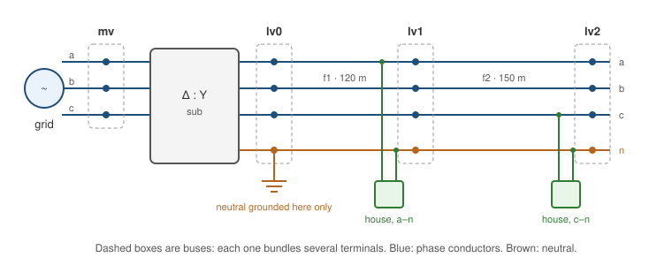

# [Anatomy of a case](@id case-anatomy)

*One small four-wire feeder, read block by block, then solved.*

A BMOPF case is a nested dictionary: component types at the top level, each
holding `id => component`. This page reads one bundled case from top to bottom
so that the reference pages have something concrete to attach to. Every block
runs when the documentation is built.

The case is a synthetic European low-voltage feeder: a 10 kV source, a
400 kVA delta-wye transformer, two four-wire cable sections, three
single-phase houses and one three-phase shop.



```@example anatomy
using BMOPFTools, JSON3

path = joinpath(pkgdir(BMOPFTools), "test", "data", "profiler_systems",
                "eu_tn_four_wire.json")
net = parse_bmopf(path)
show_block(x) = JSON3.pretty(stdout, x)   # print a block as JSON
sort([k => length(v) for (k, v) in net if v isa AbstractDict && !startswith(k, "_")]; by = first)
```

Everything is in SI units: volts, amperes, ohms, watts, meters, radians.
Nothing in the file is per-unit.

## Terminal roles

```@example anatomy
show_block(net["terminal_conventions"])
```

The labels are free-form strings. This block says which of them are phase
conductors and which is the neutral, once, for the whole case. `earth` is for
dedicated earth wires and is empty in most cases.

## Buses

A bus is a location that hosts several terminals, one per conductor.

```@example anatomy
show_block(net["bus"]["mv"])
```

```@example anatomy
show_block(net["bus"]["lv0"])
```

The medium-voltage bus is three-wire. The transformer's low-voltage bus has
four terminals, and `perfectly_grounded_terminals` pins its neutral to exactly
0 V: the substation earthing. The buses further down the feeder have a
neutral terminal with no grounding, so their neutral voltage is free to rise
under unbalanced load.

## The source

```@example anatomy
show_block(net["voltage_source"]["grid"])
```

`v_magnitude` is the voltage of each terminal **to ground**: 5773.5 V is
10 kV/√3. The angles are in radians. The source fixes these phasors and
supplies whatever current the network draws, so it is both the voltage
reference and the slack.

## The transformer

Transformers are grouped by subtype; this one is a `delta_wye`.

```@example anatomy
show_block(net["transformer"]["delta_wye"]["sub"])
```

The delta side connects to three terminals and the wye side to four: the
fourth is the star point, brought out to the bus neutral. `v_nom_from` and
`v_nom_to` are the nameplate line-to-line voltages, the series impedances are
in ohms on each winding's own side, and `s_rating` is in VA.
[Transformer models](transformer_models.md) explains every field.

## Lines and their linecode

A line carries topology and a length. Its impedance lives in a shared
`linecode`, as per-meter matrices.

```@example anatomy
show_block(net["line"]["f1"])
```

```@example anatomy
lc = net["linecode"]["cable"]
R = [lc["R_series_$(i)_$(j)"] for i in 1:4, j in 1:4] .* 1000   # Ω/km
```

The matrix is 4 × 4 because the cable has four conductors, in the order of
the line's terminal maps. The off-diagonal entries are the mutual coupling
between conductors: a current in one conductor produces a voltage drop along
all of them. This is the matrix form of Ohm's law,
``\Delta\mathbf{V} = \mathbf{Z}\,\mathbf{I}``. The reactance matrix
`X_series_i_j` has the same shape, and `i_max` rates each conductor,
including the neutral.

## Loads

```@example anatomy
show_block(net["load"]["h1"])
```

A device names the terminals it connects to. This house sits between phase
`a` and the neutral, so it is `SINGLE_PHASE` and its power arrays have one
entry. `v_nom` is the voltage at which a voltage-dependent load model draws
its nominal power; with the default constant-power model it is not used.
The other loads follow the same pattern; the shop is a three-phase `WYE`
load with three entries:

```@example anatomy
[id => (net["load"][id]["terminal_map"], net["load"][id]["p_nom"][1]) for id in sort(collect(keys(net["load"])))]
```

## Check it, then solve it

[`analyze`](@ref) profiles the case before any solver sees it.

```@example anatomy
report = analyze(net)
[(f.code, f.component_id) for f in report.findings if startswith(String(f.code), "E.")]
```

No errors. A power flow then returns one voltage per terminal:

```@example anatomy
using JuMP, Ipopt
optimizer = optimizer_with_attributes(Ipopt.Optimizer, "print_level" => 0)
result = solve_pf(net; optimizer = optimizer)

far = result["bus"]["lv2"]
[t => round(far[t]["vm"], digits = 2) for t in ["a", "b", "c", "n"]]
```

Three things to read from the far-end voltages:

- The phase voltages differ, because the loads are spread unevenly over the
  phases.
- The neutral is not at 0 V. Its return current flows through the neutral
  conductor's impedance back to the grounded star point.
- What a house receives is the phase voltage *minus* the neutral voltage, as
  phasors. That is why the neutral is modeled.

## Where each block is specified

| Block | Reference | Background |
|---|---|---|
| `terminal_conventions`, `bus` | [Data model conventions](conventions.md#Terminal-names) | [Buses & terminals primer](terminals_primer.md), [Ground, neutral & earth return](tutorial_grounding.md) |
| `voltage_source` | [Conventions: loads and generators](conventions.md#Loads-and-generators) | [Units, bases & economics](tutorial_units.md) |
| `transformer` | [Transformer models](transformer_models.md) | [From test report to transformer model](tutorial_transformer_tests.md) |
| `line`, `linecode` | [Conventions: lines](conventions.md#Lines,-linecodes-and-matrices) | [Line geometry & impedances](tutorial_line_geometry.md) |
| `load` | [Device parameter indexing](device_indexing.md) | [Choosing a load model](tutorial_load_models.md) |
| array lengths in general | [Device parameter indexing](device_indexing.md) | — |

Other component types follow the same pattern: `generator`, `ibr` (with
`control_profile`), `shunt`, `capacitor`, `switch`, and the DC tables. They
are described in [Data model conventions](conventions.md).

To build a case of your own, start from this file or from
[First case](first_case.md); to bring one in from OpenDSS, see the
[conversion guide](conversion.md).
