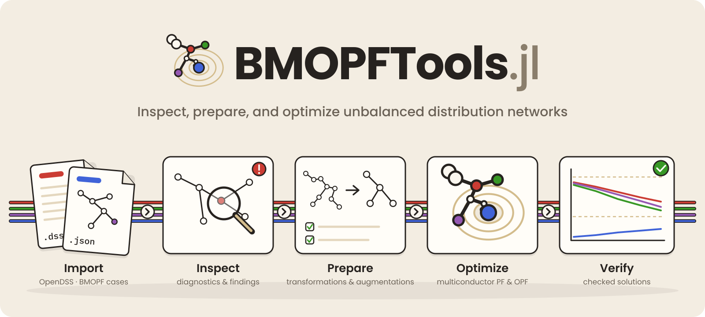
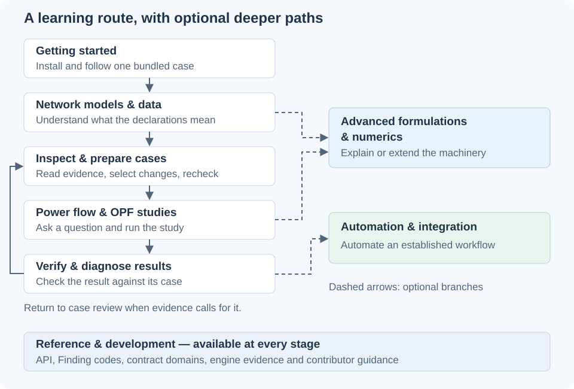

# BMOPFTools.jl

**Inspect, prepare, and optimize unbalanced distribution networks.**

BMOPFTools connects network-data diagnostics, geospatial review, and
multiconductor power-flow and optimal power flow (OPF) workflows in Julia.
Import OpenDSS or BMOPF cases, inspect their assumptions, prepare study scenarios,
and check compatible solver results. The package supports the IEEE PES Task
Force on *Benchmarking Multiconductor OPF for Distribution Systems*, whose
[specification](https://distribution-system-opt.github.io/math-and-data-model-specifications/)
defines the mathematical and data model; the
[data model specification](spec/index.md) pages here record what BMOPFTools adds
to it and how it implements it.

**New here?** BMOPFTools needs Julia ≥ 1.10 (plus JuMP and a solver such as Ipopt
for power flow and OPF). Follow [Installation & first steps](installation.md),
then [First case: inspect, solve and verify](first_case.md), which uses a bundled
synthetic feeder and needs no external dataset. If you already have a task in
mind, use [Choose your tutorial](choose_tutorial.md).

## Find your route

The main learning route is **understand → inspect and prepare → study → verify**.
Return to the case when the evidence calls for different data or assumptions.
Advanced explanations and automation are branches you can take when your task
needs them; they are not prerequisites for the first walkthrough.

| Section | What you will learn or do | Start with |
|---|---|---|
| **Getting started** | Install the package and complete one small workflow. | [First case](first_case.md), [Tutorial routes](choose_tutorial.md) |
| **Network models & data** | Understand terminals, units, grounding, model choices, the data model, and conversion conventions. | [Buses & terminals](terminals_primer.md), [Anatomy of a case](case_anatomy.md), [Data model specification](spec/index.md), [Conversion guide](conversion.md) |
| **Inspect & prepare cases** | Read the evidence, select justified changes, record assumptions, and recheck. Inspection and transformation are separate steps. | [Section overview](inspect_prepare.md), [Profile your first messy case](tutorial_profile_messy_case.md), [Case augmentation](augmentation.md), [Network reduction](network_reduction.md) |
| **Power flow & OPF studies** | Choose a study question, solver and objective; compare operating scenarios and controls. | [OPF guide](opf.md), [Case families](tutorial_case_development.md) |
| **Verify & diagnose results** | Check a returned solution against its case and investigate failures. | [Trust but verify](tutorial_trust_but_verify.md), [Power-flow comparison](solution_projection.md), [Infeasibility diagnosis](tutorial_infeasibility.md) |
| **Advanced formulations & numerics** | Understand encodings, numerical limitations, and formulation extension points. | [Choose an advanced route](advanced.md), [Extending the OPF model](differentiable_extensions.md), [Scaling & diagnostics](numerical_workflows.md) |
| **Automation & integration** | Run established checks through JSON recipes, MCP, or an AI-assisted workflow. | [JSON execution](execution_interface.md), [AI-assistant guide](ai_assistants.md) |
| **About BMOPFTools** | Why the package exists and how it relates to other tools. | [Positioning & ecosystem](positioning.md), [Why benchmarks matter](benchmarking_gap.md) |
| **Reference & development** | Look up APIs, Finding codes and contract domains, inspect implementation evidence, or contribute. | [API](api.md), [Findings](findings.md), [Engine validation evidence](validation.md), [Developer guide](dev/contributing.md) |

### Three different kinds of checking

- **Model checks** inspect input declarations, their consistency, and supported
  domains. Begin with [Analysis & reports](analysis.md).
- **Solution verification** checks a returned result against the supplied case.
  Begin with [Trust but verify](tutorial_trust_but_verify.md).
- **Engine validation evidence** documents how the implementation is tested,
  including external comparisons and their limits. See
  [Engine validation evidence](validation.md).

These answer different questions. Passing one does not substitute for the others.

## Design

The network data model is a plain `Dict{String,Any}` mirroring the BMOPF
JSON structure exactly. There are deliberately no wrapper types around the
network: data flows to and from JSON (and out to PowerModelsDistribution via
`to_pmd`) without conversion layers. Structs are reserved for outputs such as
[`Finding`](@ref), [`SummaryReport`](@ref) and [`SolutionReport`](@ref), for
options, and for engine objects; none of them wraps the network data.

Ingestion follows from this. `from_dss` is a **semantic projection** onto that
canonical model, not a byte-faithful transcode: it infers phase and neutral
identity, fingerprints voltage regulators, and records every transformation as
provenance, so the result is *analyzable and reproducible* rather than merely a
copy of the source deck. The goal is reproducible compatibility with deliberate
surgery, not losslessness — see the
[design philosophy](@ref ingest-philosophy) for the rationale and its precedents
in CIM, PowerModelsDistribution, FAIR, and tidy-data.

Every diagnostic is a `Finding` with a **stable dot-separated code**
(`E.`/`W.`/`I.` for error/warning/info) — see the
[finding-code reference](findings.md) for the complete catalog. Match on
codes, never on message text.
