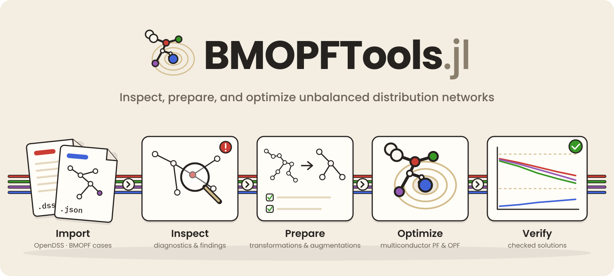
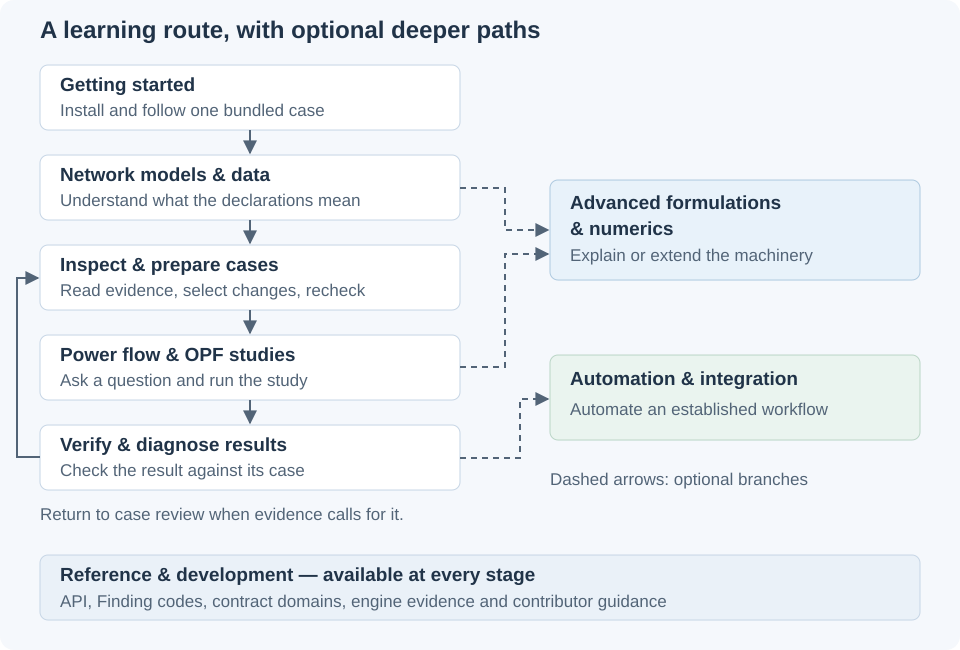

# BMOPFTools.jl



**Inspect, prepare, and optimize unbalanced distribution networks.**

BMOPFTools connects network-data diagnostics, geospatial review, and
multiconductor power-flow and optimal power flow (OPF) workflows in Julia.
Import OpenDSS or BMOPF cases, inspect their assumptions, prepare study scenarios,
and check compatible solver results. The package supports the IEEE PES Task
Force on *Benchmarking Multiconductor OPF for Distribution Systems*;
see the [BMOPF specification](spec/index.md) for the mathematical and data model.

**New here?** Follow [Installation & first steps](installation.md), then
[First case: inspect, solve and verify](first_case.md). That walkthrough uses a
bundled synthetic feeder and executes during the documentation build. You do
not need an external dataset. If you already have a task in mind, use
[Choose your tutorial](choose_tutorial.md).

## Find your route

The main learning route is **understand → inspect and prepare → study → verify**.
Return to the case when the evidence calls for different data or assumptions.
Advanced explanations and automation are branches you can take when your task
needs them; they are not prerequisites for the first walkthrough.



| Section | What you will learn or do | Start with |
|---|---|---|
| **Getting started** | Install the package and complete one small workflow. | [First case](first_case.md), [Tutorial routes](choose_tutorial.md) |
| **Network models & data** | Understand terminals, units, grounding, model choices, and conversion conventions. | [Buses & terminals](terminals_primer.md), [Conversion guide](conversion.md) |
| **Inspect & prepare cases** | Read the evidence, select justified changes, record assumptions, and recheck. Inspection and transformation are separate steps. | [Analysis & reports](analysis.md), [Spatial review](spatial_diagnostics.md), [Case augmentation](augmentation.md) |
| **Power flow & OPF studies** | Choose a study question, solver and objective; compare operating scenarios and controls. | [OPF guide](opf.md), [Case families](tutorial_case_development.md) |
| **Verify & diagnose results** | Check a returned solution against its case and investigate failures. | [Trust but verify](tutorial_trust_but_verify.md), [Power-flow comparison](solution_projection.md), [Infeasibility diagnosis](tutorial_infeasibility.md) |
| **Advanced formulations & numerics** | Understand encodings, numerical limitations, and formulation extension points. | [Choose an advanced route](advanced.md), [Model extensions](differentiable_extensions.md), [Scaling & diagnostics](numerical_workflows.md) |
| **Automation & integration** | Run established checks through JSON recipes, MCP, or an AI-assisted workflow. | [JSON execution](execution_interface.md), [AI-assistant guide](ai_assistants.md) |
| **Reference & development** | Look up APIs, Finding codes and contract domains, inspect implementation evidence, or contribute. | [API](api.md), [Findings](findings.md), [Engine validation evidence](validation.md), [Developer guide](dev/contributing.md) |

### Three different kinds of checking

- **Model checks** inspect input declarations, their consistency, and supported
  domains. Begin with [Analysis & reports](analysis.md).
- **Solution verification** checks a returned result against the supplied case.
  Begin with [Trust but verify](tutorial_trust_but_verify.md).
- **Engine validation evidence** documents how the implementation is tested,
  including external comparisons and their limits. See
  [Validating the OPF engine](validation.md).

These answer different questions. Passing one does not substitute for the others.

## Installation


BMOPFTools requires **Julia ≥ 1.10**. New to Julia? The
[Installation & first steps](installation.md) page covers installing Julia
itself (via [juliaup](https://github.com/JuliaLang/juliaup)), what the
`julia>` prompt is and where these commands go, and how to set up for the
tutorials — start there. The package is not yet in the General registry,
so install it from its Git URL at the `julia>` prompt:

```julia
using Pkg
Pkg.add(url = "https://github.com/frederikgeth/BMOPFTools.jl")
```

Parsing, validation, analysis, reporting, OpenDSS ingestion (`from_dss`, via
the [PowerIO.jl](https://github.com/eigenergy/PowerIO.jl) dependency), and the
`to_pmd` exporter work out of the box. One capability pulls in extra tooling,
activated only when you load it:

- **OPF / power flow** (`solve_opf`, `solve_pf`, `solve_feasibility_opf`) lives
  in a package extension that is loaded once **JuMP** and a solver such as
  **Ipopt** are present in the environment:

  ```julia
  Pkg.add(["JuMP", "Ipopt"])
  ```

!!! note "Tracking a moving target"
    The package is under rapid development, with breaking changes landing
    directly on `main`. Pin a specific revision when you need reproducibility:
    `Pkg.add(url = "https://github.com/frederikgeth/BMOPFTools.jl", rev = "<commit-sha>")`.

## Quickstart

[First case: inspect, solve and verify](first_case.md) walks through loading the
bundled four-wire feeder, reading its report, opening its BMOPF file in Tellegen,
solving it with JuMP/Ipopt, and profiling the result. It produces downloadable
case and report files as part of the docs build.

For a solver-free start, complete the inspection steps and stop before the solve.
For browser-only exploration, use the downloadable example in
[Visualizing a case with Tellegen](visualization.md#Try-a-small-four-wire-case).

## The pipeline

Once you can inspect and verify a small case, move to
[Developing OPF case families](tutorial_case_development.md) for scenario comparisons,
or to [Spatial diagnostics](spatial_diagnostics.md) and the
[Tellegen review workflow](visualization.md#Close-the-loop:-diagnose,-inspect,-correct,-recheck)
for geographic and electrical model cleanup.

The [utility-data end-to-end tutorial](tutorial_end_to_end.md) adds OpenDSS
conversion, structural transformations, DER placement, and augmentation on a
larger source case. It requires an external dataset with its own licence terms;
its dataset examples are displayed as code and are not executed by the docs build.
It is an optional continuation, not a prerequisite for the bundled walkthrough.

## Design


The network data model is a plain `Dict{String,Any}` mirroring the BMOPF
JSON structure exactly. There are deliberately no wrapper types: data flows
to and from JSON (and out to PowerModelsDistribution via `to_pmd`) without
conversion layers, and
the only structs in the library are the *outputs* — [`Finding`](@ref),
[`SummaryReport`](@ref), and [`SolutionReport`](@ref) — which need stable
shape for rendering and programmatic use.

Ingestion follows from this. `from_dss` is a **semantic projection** onto that
canonical model, not a byte-faithful transcode: it infers phase and neutral
identity, fingerprints voltage regulators, and records every transformation as
provenance, so the result is *analysable and reproducible* rather than merely a
copy of the source deck. The goal is reproducible compatibility with deliberate
surgery, not losslessness — see the
[design philosophy](@ref ingest-philosophy) for the rationale and its precedents
in CIM, PowerModelsDistribution, FAIR, and tidy-data.

Every diagnostic is a `Finding` with a **stable dot-separated code**
(`E.`/`W.`/`I.` for error/warning/info) — see the
[finding-code reference](findings.md) for the complete catalogue. Match on
codes, never on message text.

## Where to go next

Use [Choose your tutorial](choose_tutorial.md) for goal-based routes and
prerequisites. The sidebar follows the learning stages above, with deeper
explanations and reference material available alongside them. The
[OPF guide](opf.md) currently contains both practical usage and detailed
formulation material; follow its headings to the part your task needs.
