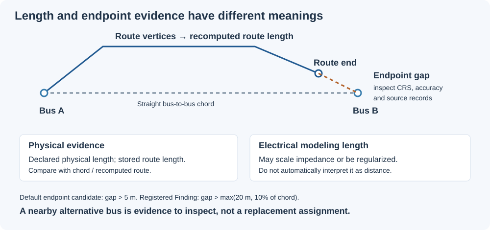
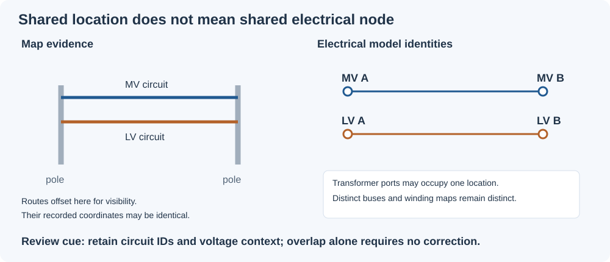
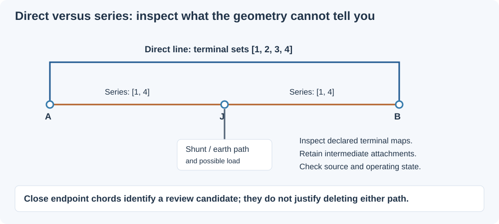
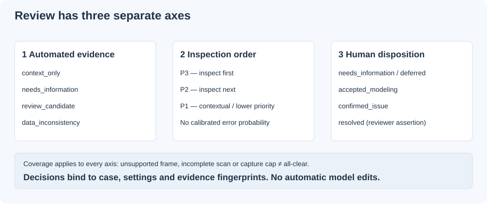

# Spatial diagnostics and cleanup review

Bus coordinates and route geometry describe a network a second time,
independently of its electrical declarations. Where the two descriptions
disagree — a line shorter than the distance between its buses, a route that ends
away from its bus, two lines drawn on the same segment — something deserves a
look. Spatial analysis finds those disagreements and tells you **what to inspect
and which source records to consult**. It cannot tell you which declaration is
wrong; that is a decision for a reviewer with access to the sources.

!!! warning "What spatial analysis never does"
    It does not merge buses, snap or transform coordinates, rewire circuits,
    delete parallel branches, edit the model, suppress Findings or certify a
    repair. Reviewer decisions are records kept outside the model, and a
    `resolved` disposition is the reviewer's assertion. A small or empty review
    queue is not an all-clear: check coordinate coverage and scan limits first.

To work through a case, follow the [spatial cleanup tutorial](@ref spatial-cleanup).
Every setting, threshold and result key is listed in
[Spatial analysis settings and result keys](@ref spatial-reference).

## What the evidence can and cannot establish

Coordinates are useful because some relations between position and length are
nearly physical laws. A conductor cannot be shorter than the straight line
between its ends, and it is rarely several times longer. A ratio between length
and distance that sits on a unit factor across a whole network is a unit slip,
not a set of individual errors. A bus at longitude 0, latitude 0 has lost its
position. These contradictions are strong enough to raise registered `W.GEO.*`
Findings, but only once the coordinate frame is declared.

Other observations are weaker and enter a review queue instead: buses close
together without a direct branch, a direct line alongside a series path between
the same buses, lines sharing an exact route segment or a source identifier,
unusually long spans. Each has legitimate explanations, so the queue records the
observation, its alternatives and what to check, without a verdict.

What geometry cannot settle:

- **Which side is wrong.** A length/chord contradiction implicates the length, the
  two bus positions, or the bus references. The evidence names the pair.
- **Electrical equivalence.** Matching endpoints or shared routes say nothing about
  conductor maps, attachments or operating state.
- **Physical infrastructure.** Coordinates and voltage labels do not verify shared
  poles, independent circuits or conductor continuity.

Spatial analysis runs by default within the connectivity pass whenever a bus has
`longitude`, `latitude`, `x` or `y`. Coordinate fields trigger it; a supported
frame declaration and valid coordinates decide which comparisons apply. Unsupported
evidence and disabled checks are reported as such, never as passes.

## Coordinate frames

A field named `longitude` may hold feet from a drawing. Guessing the frame would
produce confident nonsense, so metric comparisons — chords, route endpoints,
transformer extents, proximity — run only in a declared frame:

- a **geographic** frame (WGS84 or an accepted national datum), where distances
  are great-circle lengths;
- a **local Cartesian** frame with declared length units, where distances are
  Euclidean;
- **route evidence**: with no declaration, a valid WGS84 route whose ends match
  its bus coordinates supports the frame for those two buses only.

Any other declaration is recorded and leaves metric checks inapplicable;
conflicting declarations are ambiguous and suppress them. Without any
declaration, distances are indeterminate while length statistics and exact
coincidence remain available.

### [Which declaration do I write?](@id spatial-crs-declaration)

| Your coordinates | Declare | Result |
|---|---|---|
| Longitude/latitude in WGS84 | `"crs": "EPSG:4326"` | great-circle distances |
| Longitude/latitude in a national datum: GDA94/GDA2020 (Australia), JGD2000/JGD2011 (Japan), NAD83 (North America), ETRS89 (Europe), NZGD2000 | its EPSG code or name, e.g. `"crs": "EPSG:7844"` | great-circle distances; `datum` records the frame |
| Easting/northing on a projected grid (MGA, Japan plane rectangular, State Plane, British National Grid, UTM) | either the EPSG code, which is recorded but not interpreted (`declared_other`, metric checks inapplicable), **or** a local Cartesian frame with the grid's length unit if you accept the plane as locally Euclidean | Cartesian: Euclidean distances |
| OpenDSS `Buscoords` in feet or meters | `sideload_coordinates!(net, csv; frame=:cartesian, units="ft")` | Euclidean distances |
| A schematic drawing | nothing, or `coordinate_provenance = "schematic"` | no metric checks |

A local Cartesian frame is declared as an object:

```json
{"meta": {"coordinate_reference_system": {
  "type": "cartesian", "name": "site_grid", "units": "m",
  "axis_order": ["x", "y"]
}}}
```

The national datums are accepted because the checks compare great-circle lengths
against tolerances of `max(5 m, 10 %)`: the difference between those datum
realizations is at most a couple of meters and common to both ends of a line.
Coordinates are used as declared; nothing is transformed between datums, and a
case that mixes declarations is reported as a conflict. Treating a projected grid
as a local plane ignores its scale factor, at most about 0.1 % inside a zone of
the grids listed above and far below the tolerances; you make that choice by
declaring the Cartesian frame, the package does not make it for you. Route checks
remain geographic-only.

By default [`sideload_coordinates!`](@ref) copies OpenDSS `x,y` into
`longitude,latitude` without transforming or verifying them, so plausible numbers
do not establish a geographic frame. Use `frame=:cartesian` with the source unit
when the values are a plane.

Bus-level declarations must agree with the network frame; they cannot define a
transformation, and conflicting buses are excluded from metric and exact-group
comparisons. Named `longitude`/`latitude` fields always mean those axes: a
conflicting axis-order declaration is reported, never used to swap values.
`coordinate_provenance` and `coordinate_accuracy_m` describe reported data
quality. `schematic` and `displaced` positions are excluded from metric checks;
other labels are kept without upgrading them to surveyed evidence, and accuracy
never widens a threshold.

### PowerIO GeoLayer geometry

PowerIO-written BMOPF keeps geometry in `extras.geojson`, a GeoJSON
FeatureCollection whose `powerio_geo` member declares the coordinate space.
Spatial analysis reads only bus position fields, `line.meta.route_geometry` and
the network frame declaration, so it does not read that layer implicitly; a
coordinate-free case carrying one reports `unapplied_geolayer`. Apply it
explicitly:

```julia
net = parse_bmopf("powerio_case.bmopf.json")
layer = sideload_geolayer!(net)   # counts of applied, unmatched and invalid features
report = analyze(net)
```

[`sideload_geolayer!`](@ref) applies only a geographic WGS84 layer: bus `Point`
features become `longitude`/`latitude`, line `LineString` features become
`WGS84_geodesic_polyline` route geometry with a recomputed great-circle
`length_m`, and `meta.crs` is declared when the network has none. Projected,
diagram and unknown spaces, other CRSs and conflicting network declarations are
reported and left unapplied. Existing positions and routes are kept unless
`overwrite=true`.

## Reading the kinds of evidence

### Keep the different lengths separate



A line can carry several lengths with different meanings: the physical length
(`meta.physical_length_m`), the declared electrical length that scales impedance,
a stored route length and a route length recomputed from vertices. A regularized
electrical length (`meta.electrical_length_regularized = true`) is not evidence of
physical distance, so without a physical length the chord check is indeterminate.
The physical length, when declared, is the basis for the chord comparison.

Route `length_m` and the declared length often come from the same upstream
calculation, so their agreement is an internal-consistency check, not independent
confirmation. A declared/physical disagreement exposes, for example, a parent
line's `physical_length_m` inherited by each of its split sections, without
deciding which value should change.

An endpoint gap between a route and its bus can come from bus placement, stale
route geometry or a wrong bus reference. Check the frame, reported accuracy and
source provenance before deciding which declaration to change. A nearby
alternative bus is listed as a lead, never selected as a replacement.

### Shared locations can be intentional



MV and LV circuits often share poles, and same-voltage parallel circuits may share
a route. A transformer has several ports at one location; an open switch can
separate buses with identical coordinates. None of these requires a spatial
repair. The queue therefore classifies overlap between lines of different known
voltage systems as context, using source-propagated voltage labels (never
coordinates) evaluated over every member of a group. Independent endpoint or
length contradictions on the same lines are still reported on their own.

Exact coincidence is raw equality within one coordinate field family, with no
snapping. Groups are tagged by direct branch context (transformer ports, line,
open/closed/unknown switch, or no direct branch); coincidence alone emits no
Finding.

### A nearby series path is not a redundant circuit



The direct/series check compares bus chords and declared incidence: a direct line
whose endpoints are also joined by a line-only path of similar chord length. That
may be a duplicate representation or a legitimate parallel path. A grounding
shunt or load at the interior bus J makes removal consequential even when the
endpoint geometry is identical. Each such item therefore carries
`interpretation_evidence`: oriented terminal maps, attachments at interior buses,
each line's lengths and any source declarations (`origin`, `claim`,
`placeholder`, …) with their metadata paths. Equal terminal sets at a bus do not
compose conductor paths, and producer claims such as "placeholder" remain claims.

### Proximity and topology

Proximity groups buses within a radius (default 1 m, a review setting rather than
a survey tolerance). Clusters use single linkage, so A near B and B near C may form
one cluster with A far from C; a cluster is not a common electrical node.

The bus graph used for topology candidates is descriptive: lines and all ports of
supported transformers join bus components regardless of galvanic isolation,
closed switches join the certain graph, and switches of unknown state join only
the possible graph. Nearby pairs are then labeled as in the same component, in
separate components, or uncertain. This is not conductor reachability or
energization.

## Category, priority and disposition are separate



Every queue item is described on three independent axes:

- **Category** — what the automated evidence supports: `context_only`,
  `needs_information`, `review_candidate` or `data_inconsistency`. A
  `data_inconsistency` identifies conflicting declarations without saying which
  is wrong. No automated category means "confirmed issue".
- **Priority** — the order of inspection, P3 first to P1 last, with directly
  attached loads and component counts as tie-breakers. Priority is ordinal: it is
  not an error probability, electrical severity or downstream impact.
- **Disposition** — the reviewer's decision: `confirmed_issue`,
  `needs_information`, `deferred`, `accepted_modeling` or `resolved`. Only a
  reviewer sets it.

Decisions never change categories or counts. They move items between the
attention, context and reviewed views of the report: unreviewed context sits apart
from attention items, and accepted or resolved items move to a reviewed inventory
rather than disappearing. Category counts count observations, not unique defects.
The mapping from evidence to category and priority is tabulated in the
[reference](@ref spatial-review-priorities).

`W.GEO.*` codes are registered Findings in the
[GEO reference](findings.md#GEO-—-declared-coordinate-frames). The `S.*`
candidate codes and `R.LINE_LENGTH_CONTEXT` label review items; they are not
Finding codes.

## Completeness and budgets

Every search has a budget, and the queue has a capture cap. Results distinguish
observed from captured candidates and report scan and capture completeness per
check. When a budget runs out, totals become `null` and observed counts are lower
bounds. The queue is ranked within the captured subset only, so a cap can hide a
higher-priority candidate; `queue_complete = false` means some scan, capture or
the final queue is incomplete. Completeness also refers only to the declared
domain: buses without usable geometry are outside it, and the coverage fields say
how many. Raise the budget and re-analyze before treating a queue as exhaustive.

## Decisions are bound to the evidence

A decision is an assertion about specific evidence, so each record carries three
fingerprints: of the whole case, of the analysis policy and `[spatial]`
configuration, and of the item's evidence. Any change to the case — even one
unrelated to the item — or to any spatial setting turns earlier decisions into
`stale_decision`. The package will not assume evidence is unchanged.

In practice, review a batch, apply the corrections together, re-analyze, then
re-record the decisions that still apply. Stale records stay in the audit trail.
A record whose item no longer exists is reported as unmatched; that is the
expected outcome after a correction, but absence can also come from a capture
limit or a changed identity, so unmatched never means resolved. Keep the ledger
in its own file and replay it whole on each new analysis: a replay never inherits
dispositions from an earlier one. The ledger schema is in the
[reference](@ref Sidecar-dispositions); the workflow is in the
[tutorial](@ref spatial-cleanup).

## Reading the report

`render(report, "report.md")` includes the spatial section. It opens with a
coordinate-coverage banner — eligible and excluded buses, the resolved frame,
reported-accuracy coverage — because the queue cannot be read without it. A
candidate index links to the attention items below; context and reviewed items
have their own inventories. Each list shows up to 20 entries with shown/total
counts; [`render_spatial_review`](@ref) and [`export_spatial_review`](@ref) take
`item_limit` to change this, without changing the captured queue. Full asset IDs
are in each entry and in the JSON; row numbers are navigation aids that change on
regeneration. A location group is an inspection anchor, not proof that every
subject sits at that point.
