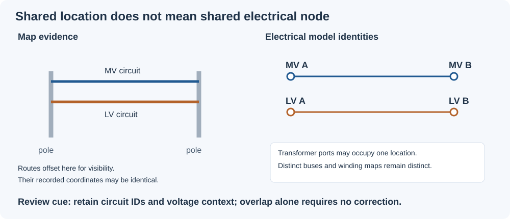
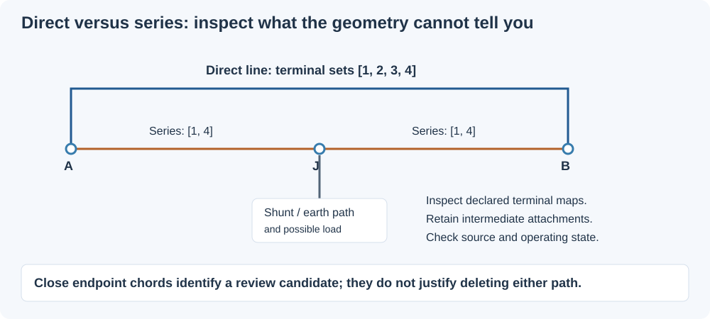
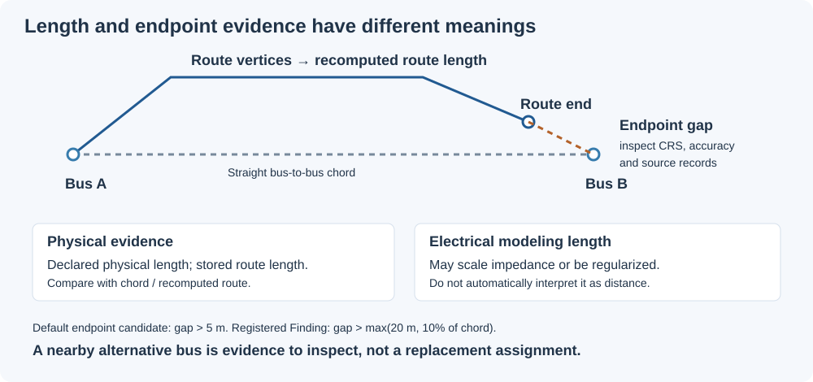
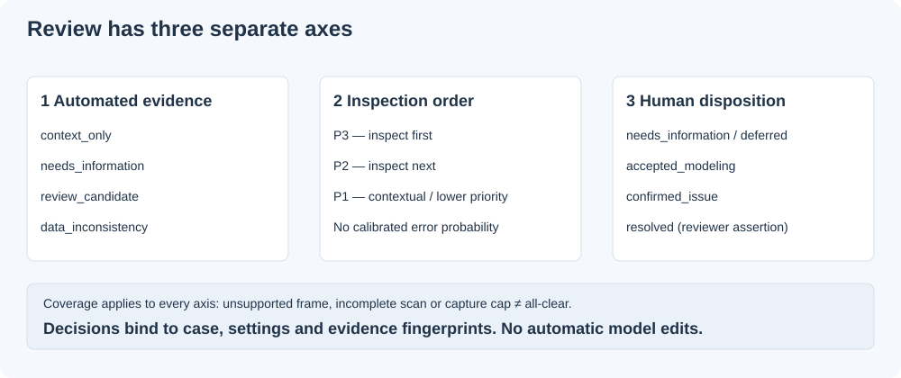

# Spatial diagnostics and cleanup review

Use spatial evidence to decide **what to inspect and which source records to
consult** while cleaning an electrical model. The analysis does not merge buses,
rewire circuits, delete parallel branches or certify a repair.

```julia
using BMOPFTools
report = analyze("NetworkModel.bmopf.json")
render(report, "report.md")  # spatial section is included automatically
spatial = get(report.results[:connectivity], "spatial", nothing)
if spatial !== nothing && haskey(spatial, "cleanup_review")
    review = spatial["cleanup_review"]
    paths = export_spatial_review(review, "cleanup"; item_limit=100)
end
```

The standalone bundle contains Markdown, the complete captured JSON queue,
WGS84 evidence points in GeoJSON, and a decision-ledger template. The display
limit applies independently to attention, context and reviewed sections; it does
not enlarge the analysis capture budget. Existing reports are replaced and an
existing decision template is preserved. Save actual decisions in a separate ledger.
For an IO stream, use `render_spatial_review(review, io; item_limit=100)`.
See the [public API reference](api.md#Spatial-cleanup-review).

## Read the evidence before choosing a disposition

### Shared locations can be intentional



MV and LV often share poles. Same-voltage parallel circuits may also share a route.
These observations alone do not imply duplication. The report retains distinct
bus/line identities and voltage labels; it does not infer that poles are shared.
A transformer can have several ports at one physical location. An open switch
can separate buses with identical coordinates. Neither requires a spatial repair.
Independent length or endpoint contradictions still warrant inspection.

### A nearby series path is not a redundant circuit



The direct/series detector compares bus chords and declared incidence. To decide
whether a candidate is a duplicate representation, inspect conductor maps,
intermediate attachments, circuit identifiers, operating state and source records.
A grounding shunt or load at J can make removal consequential even when the
endpoint geometry looks identical. The diagram is illustrative, not a reduction rule.

Each direct/series item now includes `interpretation_evidence`:

- Direct and series line maps oriented along the candidate path, plus comparisons
  of declared terminal **sets at the same bus**. Equal sets do not compose conductor
  paths or prove electrical equivalence; malformed/missing maps are indeterminate.
- Intermediate load, shunt, source, generator, solar and storage references, with
  terminal maps, and explicit bus `perfectly_grounded_terminals`. Shunts may model
  grounding, but the report does not assign a grounding role from their names.
- Each line's declared, physical, chord and route lengths, with its comparison basis.
- Literal source declarations with metadata paths. The supported scalar keys are
  `origin`, `evidence_status`, `claim`, `attachment_mode`, `method`, `source_ref` and
  `placeholder`, read directly under `meta` or one dictionary level below it.
  Historical nested models are not searched. Missing fields mean unavailable
  provenance, not observed construction. Claims such as `inferred_not_observed`
  or “placeholder” remain statements made by the producer, not verified facts.

This enrichment does not alter candidate identities, classifications or priorities.
It is included in evidence fingerprints, so earlier decisions on enriched items
require renewed review rather than silently applying to changed evidence.

### Keep the different lengths separate



An endpoint gap can arise from bus placement, stale route geometry or an incorrect
bus reference. Check CRS, reported accuracy and source provenance before deciding
which declaration to change. The default candidate tolerance is 5 m; the registered
route-endpoint Finding uses `max(20 m, 10% of chord)`. Reported coordinate accuracy
does not silently change either threshold. A nearby alternative bus is an inspection
lead, never an automatically selected replacement.

Physical length, stored route length, recomputed route length and electrical
modelling length may have different meanings. In particular, regularized electrical
length is not automatically evidence of physical distance. The length section below
specifies which value participates in each comparison.

### Separate observation, assessment and human decision



`W.GEO.*` codes are registered Findings, documented in the
[GEO reference](findings.md#GEO-—-declared-geographic-coordinates).
`S.*` codes label spatial candidates and `R.LINE_LENGTH_CONTEXT` labels reviewable
length context; these are **not additional Finding codes**. An automated
`data_inconsistency` can identify conflicting declarations without determining
which source is wrong. Only a reviewer records `confirmed_issue`.

Priorities run from P3 (inspect first) to P1; they are not probabilities. Category
counts count observations, not unique defects. Check applicability, eligible
coordinate coverage and scan/capture limits before interpreting a small or empty
queue. Unsupported evidence and disabled checks are never an all-clear.

## Activation and coordinate semantics

Geospatial analysis is **enabled by default** within the connectivity pass. With
normal settings, `results[:connectivity]["spatial"]` appears when at least one bus
has `longitude`, `latitude`, `x`, or `y`. Coordinate fields trigger inspection;
valid coordinates and supported frame declarations still determine which metrics
are applicable. Cases without bus coordinate fields skip spatial analysis.

The JSON execution API accepts `execute_analysis(net; spatial_enabled=false)`.
The CLI accepts `bin/bmopf analyze-case --input CASE.json --no-spatial`, and the
MCP `bmopf_analyze` tool accepts `"spatial_enabled": false`. These are Boolean
opt-outs; the response records the effective value. See
[JSON execution](execution_interface.md#Suppressing-geospatial-analysis).

To suppress the entire spatial pass while keeping the other analyses:

```julia
config = load_config()
config["spatial"]["enabled"] = false
report = analyze("NetworkModel.bmopf.json"; config=config)
render(report, "report.md")
```

Alternatively, save the override in a TOML file and pass
`config=load_config("analysis-config.toml")`:

```toml
[spatial]
enabled = false
```

The same configuration works with `connectivity_analysis`. Suppression happens
before coordinate inventory, route processing, proximity searches, topology
candidates and cleanup capture. It produces no `W.GEO.*` Findings. JSON retains
only an `inapplicable` / `disabled` spatial record with `analysis_performed=false`;
Markdown explains that geographic checks were not run. This explicit disabled
record is present even for a coordinate-free case. Other analysis and validation
results are unaffected. A non-boolean `enabled` or non-object spatial section
returns `indeterminate` / `invalid_configuration`, rather than silently enabling
the pass. Omitted settings retain the enabled default.

The existing `proximity_enabled`, `discrepancy_enabled` and `review_enabled`
settings control individual parts when the whole pass is enabled. The standalone
cleanup bundle requires an available cleanup report and reports an error when the
entire spatial pass is disabled.

When enabled and coordinates exist, the report includes coordinate and route coverage,
line-length distributions by voltage tier, and bounded long-line witnesses.
The long-line ranking compares each section with its own tier's 99th-percentile
declared length; a high rank is an inspection cue, not an error threshold.
Geographic line chord, route endpoint, and transformer separation measurements
are computed only when network metadata declares WGS84 (`crs`,
`coordinate_system`, or `coordinate_reference_system`) or a matching
`WGS84_geodesic_polyline` route provides coordinate-frame evidence. The latter
is explicitly labeled as route evidence and applies only to bus endpoints
matched to a fully valid route; it does not establish the frame of other buses.
`n_metric_eligible_buses` and `distance_scope` expose this coverage.
Out-of-range and incomplete coordinate pairs are counted but excluded from
geodesic calculations.

The coordinate loader copies OpenDSS `x,y` into fields named
`longitude,latitude` without transforming or verifying them. Plausible numeric
values therefore do not establish a geographic CRS. When the frame remains
unspecified, spatial distances remain indeterminate; a declared unsupported CRS
makes bus geodesic comparisons inapplicable. Line-length statistics remain available. The result makes no
automatic asset-error claim when the CRS is unspecified. With a network-level
WGS84 declaration, out-of-range bus coordinates and sufficiently large line
chord or route-endpoint contradictions raise `W.GEO.*` Findings. For the chord
Finding, `line.meta.physical_length_m` takes precedence over `line.length`.
If `electrical_length_regularized = true` and no physical length is supplied,
the physical chord check is indeterminate and emits no length Finding.
Invalid explicit physical metadata also prevents fallback to declared length.
Without these metadata fields the declared length remains the comparison basis.
A line's equivalent electrical length can differ from its physical route, so
these warnings call for source-data review rather than automatic repair.
Route `length_m` and declared line `length` may come from the same upstream
geometry calculation, so their agreement is an internal-consistency check,
not independent confirmation of the physical route.

The spatial result groups fields as follows:

| Key | Contents |
|---|---|
| `coordinate_reference` | `status`, declared CRS if any, caution text, matching WGS84 route count, and whether geodesic distances apply. Status is `declared_wgs84`, `wgs84_route_evidence`, `declared_other`, or `unspecified`. |
| `coordinate_coverage` | Counts of complete longitude/latitude pairs, x/y fields, partial and invalid pairs, and pairs outside WGS84 numeric ranges. |
| `routes` | Route and basis coverage, numbers of endpoint and length comparisons, mismatch counts, and bounded endpoint-gap witnesses. |
| `lines` | Length quantiles by voltage tier, chord comparison count, shorter-than-chord count, and bounded absolute and tier-relative length witnesses. |
| `coincidence` | Exact-coordinate groups, counts by direct branch context, and bounded bus/terminal/component witnesses. |
| `coordinate_semantics` | Resolved frame, units, axis order, declarations, conflict reasons, provenance/accuracy coverage and bounded bus issue witnesses. |
| `proximity` | Radius-neighbor counts, exact metric-location counts, single-linkage clusters, bounded evidence, and explicit search-budget/coverage status. |
| `length_context` | Separate declared, physical, endpoint, stored-route and recomputed-route lengths; per-comparison status counts and bounded contextual witnesses. |
| `transformers` | Maximum all-winding bus separation per transformer, quantiles, zero-extent counts, and bounded assessed/indeterminate witnesses. |

Exact coincidence is descriptive equality within a coordinate field family,
including `x/y` buses when they have no longitude/latitude fields. It needs no
metric CRS and does not snap almost-equal coordinates. Invalid pairs and points
outside an explicitly declared WGS84 range are excluded. A group may carry
multiple context tags: `transformer_ports`, `line_connected`, `open_switch`,
`closed_switch`, or `unknown_switch_state`. `no_direct_branch` means no line,
switch, or transformer directly relates two distinct members; it says nothing
about paths through other buses. None of these tags proves intent, duplication,
or a need to merge buses. No Finding is emitted solely for coincidence.

Witnesses retain bus voltage tiers and terminal names, plus declared component
ports and terminal maps. Selection is deterministic and keeps examples for each
context (five per context admission limit), with at most 20 member buses and 20
internal components per group. Exact totals and truncation flags accompany
bounded lists. Many legitimate transformer ports therefore cannot hide all
groups without direct branch context.

Transformer extent uses the maximum pairwise separation across **all** winding
buses, including `n_winding`, rather than only distances from winding 1. Every
winding must have eligible coordinates; missing or unsupported evidence yields
an indeterminate witness instead of a partial extent. Zero extent is counted
as descriptive context and is not an anomaly by itself.

`length_context` compares the physical length (or eligible declared-length
fallback) against the endpoint distance, recomputes WGS84 route lengths from
all vertices, compares stored versus recomputed route length, and separately
compares declared versus physical length. Each comparison reports `passed`,
`failed`, `indeterminate`, or `inapplicable`; these are data-consistency statuses,
not scientific preservation or feasibility claims. Unknown bus frames and
missing measurements are indeterminate; explicitly unsupported bus frames or
route bases are inapplicable. A separately labelled WGS84 route can be measured
internally without establishing the coordinate frame of its buses.

Each comparison uses `max(5 m, 10% of reference distance)`; the endpoint test is
one-sided and the other comparisons are symmetric. Witnesses preserve the basis,
threshold, regularization flag, source references, and whether declared length
scales impedance. Invalid route vertices or lengths never enter a calculation.
Five examples per context admission limit keep output bounded while retaining
exact counts. No new Finding codes are emitted by these contextual comparisons.
The older `lines` and `routes` counters still compare **declared** lengths; they
are descriptive and may differ from the physically qualified Finding count.
For example, splitting a line may leave parent-level `physical_length_m` on
each child section. The declared/physical comparison exposes that discrepancy
without identifying which value should change or inferring a transformation
mapping from shared source IDs. `test/data/spatial_split_lengths.json` is a
package-owned synthetic witness of this metadata pattern.

Coordinate declarations are resolved across the root and `meta` fields
`coordinate_reference_system`, `crs`, and `coordinate_system`. Equivalent WGS84
aliases agree; conflicting or malformed declarations yield `ambiguous` and
suppress metric comparisons. Named `longitude`/`latitude` fields always mean
those axes. A conflicting `coordinate_axis_order` is reported, never used to
silently swap values. WGS84 defaults to degrees; a conflicting explicit
`coordinate_units` suppresses its metric interpretation.

Local Cartesian frames must be declared explicitly, for example:

```json
{"meta": {"coordinate_reference_system": {
  "type": "cartesian", "name": "site_grid", "units": "m",
  "axis_order": ["x", "y"]
}}}
```

These frames use named bus `x`/`y` fields, with `m`, `km`, or international `ft`
units (scales 1, 1000, and 0.3048 metres). Axis/unit declarations may also use
`coordinate_axis_order`/`coordinate_units` on the root or in `meta`; multiple
declarations must agree. A Cartesian frame without units is indeterminate.
Projected EPSG codes are unsupported; no projection or map-scale assumption is
inferred. Cartesian distances feed the descriptive length and transformer
extent reports; existing `W.GEO.*` Findings retain their WGS84 domain.

Bus-level CRS, axis, or unit declarations must agree with the network frame
(or the WGS84 route evidence supporting that bus); they cannot silently define
a transformation. Conflicting buses are excluded from metric and exact-group
comparisons. Network-level ambiguity also suppresses exact groups, rather than
combining positions from unresolved frames. Unknown undeclared frames still
permit descriptive raw coordinate equality without a metric interpretation.

`coordinate_provenance` (a string) and `coordinate_accuracy_m` (a finite
nonnegative number) may appear on a bus or its `meta`, with network-level
defaults in the same locations. Conflicting declarations within one scope are
reported; explicit bus values override network defaults. `schematic` and
`displaced` coordinates are excluded from metric checks. Other provenance
labels are retained without upgrading them to surveyed evidence. Invalid
accuracy is reported as unknown while a valid coordinate remains usable.
Accuracy values describe reported data quality; they do not certify error
bounds or independent measurement.

Proximity inventory runs on metric-eligible coordinates only. Configure it
through `load_config` and pass `config=...` to `analyze` or
`connectivity_analysis`:

```toml
[spatial]
proximity_enabled = true
proximity_radius_m = 1.0
max_candidate_pairs = 1000000
witness_limit = 20
```

The radius must be finite and positive; the candidate and witness limits must
be positive integers. Invalid settings return `indeterminate` with
`invalid_configuration`; disabling the pass returns `inapplicable`. The default
one-metre radius is a review setting, not a survey-accuracy or electrical-rule
threshold. Coordinate accuracy never expands it implicitly.

A spatial hash indexes unique locations, avoiding all-pairs searches for sparse
networks. Cartesian points are indexed in metres; WGS84 points are indexed on
the sphere in three dimensions and then filtered by the same spherical
geodesic used elsewhere in this report. This handles the antimeridian and
poles without assuming a local projection. Equivalent positions at ±180° and
the poles are canonicalized for metric-location counting. Raw exact-coordinate
groups remain a separate observation.

`n_near_bus_pairs` counts unordered bus pairs at **different** metric locations
whose separation is at most the radius. Repeated locations are indexed once
and pair counts use their multiplicity; `n_zero_distance_bus_pairs` reports
coincident metric positions separately. Clusters use single linkage: A near B
and B near C may form one cluster even when A is farther than the radius from C.
They do not imply a common electrical node or a cluster diameter below the
radius. Pair witnesses identify representative bus pairs and their voltage
tiers, coordinate provenance, reported accuracy sum, and location multiplicity.
Accuracy labels apply to the named representatives only, and are descriptive,
not certified uncertainty bounds.

`max_candidate_pairs` caps work on dense unique locations. If exhausted, or if
coordinates/radius exceed the index's numerical range, the result is
`indeterminate`, `counts_complete` is false, and final pair/cluster totals are
JSON `null`. `n_near_bus_pairs_observed` is a lower bound; observed components
are partial and may later merge, so their count is **not** a lower bound on
final cluster count. Cluster witnesses explicitly mark completeness. The
witness limit bounds pair examples, cluster examples, and members per cluster.
No coordinates or network connections are changed, and proximity alone emits
no Finding.

Endpoint gaps are counted with a 5 m descriptive threshold; the route-endpoint
Finding threshold is `max(20 m, 10% of endpoint chord)`. Route/declaration length
differences use `max(5 m, 10% of declared length)`; the line/chord lower-bound
check uses `max(5 m, 10% of chord)`. A mismatch count is JSON `null` when no
eligible comparison was made, rather than zero. Geographic Findings require
an explicit WGS84 declaration; matching route evidence alone supports
measurements but does not assert the CRS of every bus.


## Geometry and topology review candidates

`discrepancy_candidates.checks` adds descriptive review categories to the spatial
report. These `S.*` candidate codes are stable package-local categories, **not
Finding codes**, electrical-equivalence claims or repair instructions. They add
no PSK preservation claim. JSON retains terminal maps, voltage tiers, coordinate
provenance, switch states and branch references; Markdown summarizes bounded
witnesses. The synthetic `test/data/spatial_discrepancies.json` demonstrates a
direct line alongside a series path, shared geometry, a repeated explicit source
interval and a route ending near a different bus.

| Check | Candidate code | Supported evidence |
|---|---|---|
| `nearby_topology` | `S.NEARBY_WITHOUT_DIRECT_BRANCH` | Metric-eligible bus pairs within the proximity radius, including exact co-location, with no direct line, switch or supported transformer declaration. |
| `series_paths` | `S.DIRECT_ALONGSIDE_SERIES_PATH` | A direct line and a line-only path with degree-two interior buses; path chord sum is within `max(route_endpoint_tolerance_m, 10% of endpoint distance)` of the direct chord. |
| `branch_spans` | `S.LONG_BRANCH_SPAN` | A line, switch or all-winding transformer span exceeds the configured absolute review distance. |
| `route_endpoints` | `S.ROUTE_ENDPOINT_DISAGREEMENT` | A valid WGS84 route disagrees with its eligible WGS84 bus coordinates under the better of forward/reversed endpoint assignments. Nearby alternative buses are listed without assigning them. |
| `route_overlaps` | `S.SHARED_ROUTE_SEGMENT` | Two or more lines contain exactly the same nonzero WGS84 vertex-to-vertex segment, allowing reversal. |
| `source_intervals` | `S.REPEATED_SOURCE_INTERVAL` | An explicit nonempty string ID repeats within `meta.source_interval` or within `meta.backbone_extension.source_interval`. The two namespaces are kept separate. |
| `route_defects` | `S.INVALID_ROUTE_GEOMETRY`, `S.ROUTE_SEGMENT_DEFECT` | Malformed route data, zero or repeated undirected WGS84 segments, or individual segments above the configured long-span threshold. |

The bus graph is descriptive: lines and all ports of supported transformers join
bus components regardless of galvanic isolation or terminal mappings. Closed
switches join the certain graph; switches with missing/non-Boolean state join
only the possible graph. Known open switches join neither graph but remain
visible as direct declarations and incident branches. Nearby pairs distinguish
same components, separate components, and uncertain separation due to unknown
switch state or invalid branch declarations. This is **not** conductor reachability,
energization or evidence that buses should be merged. `endpoint_like` means at
least one bus has at most one incident branch declaration, including open switches.

Series-path searches stop at a branch, switch or transformer port in the interior,
and never establish a valid series reduction: an interior bus can carry loads or
other attachments, which are reported. The geometry test uses bus chords; it does
not assert route coincidence. Shared-segment and repeated-source groups retain
line identities, feeder labels, bus pairs and orientation-aligned terminal maps;
separate circuits can legitimately share these attributes. Groups additionally label
the declared endpoint arrangement as a series chain, parallel bus pair, branched
or cyclic graph, or disconnected graph. These labels do not infer electrical
equivalence. Nearby-pair component and voltage-tier counts carry an `_observed`
suffix and cover the whole scanned subset, independently of witness limits.
Generic `raw_key`
parent IDs are not interpreted as source intervals. Routes with different
segmentation, partial collinear overlaps, geometric crossings, self-intersections
without a repeated segment, arbitrary alternate paths and inferred source-to-target
mappings remain unassessed.

```toml
[spatial]
discrepancy_enabled = true
max_topology_pairs = 100000
max_series_hops = 8
route_endpoint_tolerance_m = 5.0
long_span_threshold_m = 10000.0
```

The proximity radius, location-pair budget and `witness_limit` from the previous
section also apply. `max_topology_pairs` independently caps nearby bus-pair
expansion, series path steps, branch-span distance pairs, route-segment processing
and route-endpoint bus queries. It is a positive integer. `max_series_hops` is an
integer from 2 through 64. Both distance settings must be finite and positive.
The 10 km long-span default is an absolute review setting, not a voltage-specific
engineering limit or statistical outlier test. All counts are within each check's
stated domain; explicit coverage fields report excluded or unsupported evidence.
A scan with no eligible geometry is not a zero-candidate success. Disabled passes
are `inapplicable`; invalid settings and truncated scans are `indeterminate`.
Incomplete scans retain `n_candidates_observed` as a lower bound and leave
`n_candidates` null. Witness truncation alone does not invalidate aggregate counts.

WGS84 route-shape evidence is independent of the bus coordinate frame. Unknown or
conflicting bus frames suppress endpoint distances and alternative-bus searches,
but an explicitly WGS84 route can still contribute shared-segment or route-defect
evidence. All algorithms are read-only and make no snapping, rewiring, merging or
circuit-deletion decisions.

## Cleanup review workflow

`results[:connectivity]["spatial"]["cleanup_review"]` is a review queue over the
spatial candidate categories and earlier line-length context. A line with
only `regularized_electrical_length` context is not queued. Coordinate coverage,
exact-coincidence inventories and transformer extents remain separate context;
this queue is not a complete inventory of all model defects.

```toml
[spatial]
review_enabled = true
max_review_candidates = 5000
```

The cap is a positive integer up to 100000. Each check independently captures up
to that many candidates, regardless of `witness_limit`; the combined ranked queue
is capped again. `coverage` reports observed/captured counts, scan status and
capture completeness by check. Each check's `domain_counts` retain exclusions
such as unavailable branch distances; `coordinate_context` states the frame and
metric bus coverage, and `analysis_settings` records the spatial configuration.
Completeness refers to candidates in the declared domain, not to every bus or
branch having usable geometry. `queue_complete=false` means that scans, capture,
or the final queue are incomplete. Disabled discrepancy scans also prevent a
complete queue. Unsupported/inapplicable domains are disclosed, never upgraded
into validated cases. The queue is ordered **within the captured subset**; a cap
can hide later candidates of higher priority. Increase the budget and regenerate
before treating the queue as exhaustive within its stated scope.

Each item has a stable logical `item_id`, its evidence fingerprint, typed bus and
component references, geometry basis, direct-subject impact counts, and a recorded
or unreviewed disposition. IDs distinguish shared segments and transformer types;
a moved segment may have a new identity. Records bind to canonical SHA-256
fingerprints of the entire network snapshot, spatial configuration, workflow and
ranking-policy versions, and item evidence. Only ingestion bookkeeping timestamps
`_meta.parsed_at` and `meta.provenance.parsed_at` are excluded from the case hash;
other provenance remains binding. Object key order and equivalent integral JSON number
spellings do not affect fingerprints. Even an unrelated network edit invalidates
old decisions conservatively; these hashes are not the raw input file hash.

Location groups use the first sorted evidence point in a supported frame, with
exact equality only. Unlocated items group by a typed primary asset. Grouping
organizes inspection; it does not establish physical co-location of all members
or authorize merging buses. There is no spatial snapping or transitive clustering.
Group summaries deduplicate identified buses/components and retain evidence classes.
Their ordering uses maximum item priority, maximum item direct-load count (not a
sum), unique component count, then location ID; it does not inflate priority from
multiple diagnostics derived from the same geometry.

### Evidence categories and shared infrastructure

Each item has an `assessment` with a category, observation, interpretation,
uncertainty, suggested source inspection, and voltage context where available.
Categories describe evidence, independently of inspection priority and reviewer
disposition:

| Category | Interpretation |
| --- | --- |
| `context_only` | An observation without sufficient conflicting evidence to warrant correction. |
| `needs_information` | Missing voltage or topology evidence prevents interpretation. |
| `review_candidate` | Additional declaration evidence warrants inspection; legitimate arrangements remain possible. |
| `data_inconsistency` | Malformed data or conflicting supported declarations; the responsible field and electrical consequences remain unresolved. |

No automated category means **confirmed issue**. That remains an explicit reviewer
disposition. `category_counts` count captured observations, not defects;
`presentation_counts` distinguish `attention`, `context` and `reviewed` items.
Context alone is excluded from the attention view. Reviewer dispositions
`confirmed_issue`, `needs_information` and `deferred` put an item in that view even
when its automated evidence is contextual; `accepted_modeling` and `resolved`
move it to the reviewed view without deleting it. Category counts remain unchanged
by decisions. Location groups also retain category counts.

Shared-route and source-interval groups carry each captured line's endpoint
voltage labels and an aggregate `voltage_context` evaluated over **all members**,
including members omitted by the witness cap. Labels come from the existing
source-propagated voltage analysis, never from coordinates. Different known
voltage systems with matching labels at both ends of each line are compatible
with shared infrastructure. This does not verify shared poles, independent
circuits or correctness of voltage propagation. Matching voltage labels and
parallel bus pairs also do not turn overlap alone into a duplicate-asset claim.
Unknown labels remain `needs_information` unless an independent series-chain or
different-terminal-map explanation supplies representation context. A line whose
endpoint labels differ remains a separate review candidate, even in a mixed-tier
group. Independent endpoint and length discrepancies are never suppressed by a
contextual overlap classification.

Inspection priority uses `spatial-review-priority/v2`:

- **P3:** malformed geometry/length declarations, a length below its applicable
  endpoint bound, or route endpoints disagreeing with connected bus coordinates.
- **P2:** direct/series declarations, nearby separate same-tier components,
  missing voltage/topology information, non-regularized length discrepancies,
  grouped lines crossing voltage labels, unexplained repeated source identities,
  and degenerate or retraced route segments.
- **P1:** contextual proximity or shared infrastructure, legitimate parallel-route
  possibilities, series segmentation, distinct terminal maps, regularization
  interpretation, and absolute long-span thresholds.

Within a priority, directly attached load count and identified component count
order inspection, followed by item ID. Counts cover directly referenced subjects,
can be lower bounds when member lists are truncated, and never estimate downstream
load, electrical severity, independent evidence strength or error probability.
`assessment.error_probability` is null; no probability has been calibrated.
The policy version is bound into the analysis fingerprint, and assessments and
coordinate evidence into item fingerprints. Decisions from older classification policies do not
silently apply to newly classified reports. Existing v1 report payloads remain
readable, but regeneration is required for the new classifications.

Synthetic expectations are executable in `test/data/spatial_review_calibration.json`
and `test/data/spatial_shared_infrastructure.json` with its companion tests;
supplied SAPN and Springfield cases provide structural calibration only. No field
precision/recall is claimed.

### Sidecar dispositions

Use the existing `analyze` report, and keep decisions outside the electrical model:

```julia
report = analyze(net)
review = report.results[:connectivity]["spatial"]["cleanup_review"]
item = first(review["items"])  # select the item you actually reviewed
record = spatial_review_decision(review, item["item_id"];
    disposition="needs_information", reviewer="reviewer-id",
    recorded_at="2026-10-24T01:00:00Z",
    rationale="Check the source survey and terminal mapping.",
    evidence_refs=["survey:example-record"])
# Append record to your saved ledger; replay the entire ledger on a fresh queue.
reviewed = apply_spatial_review(review, [record])
report.results[:connectivity]["spatial"]["cleanup_review"] = reviewed  # for report rendering
geojson = spatial_review_geojson(reviewed)
```

Dispositions are `unreviewed`, `needs_information`, `confirmed_issue`,
`accepted_modeling`, `deferred` and `resolved`. Every record requires a nonempty
reviewer and rationale, an explicit UTC timestamp at second precision, exact
fingerprints and a list of evidence references (which may be empty). References
are preserved as text, never fetched or executed. `resolved` is a reviewer
assertion, not a verified repair; the candidate remains visible.

`apply_spatial_review` returns a copy, applies the latest UTC timestamp per item,
and preserves the entire ledger in `decision_audit`. Identical duplicate records
are harmless. Contradictory simultaneous records, malformed records targeting an
item, edited item evidence, or stale fingerprint bindings leave the item unreviewed
with an explicit status. Older records are retained. Records for absent items are
unmatched; absence can reflect capture limits or changed identity and never implies
resolution. Replaying an empty ledger resets dispositions rather than inheriting
an earlier application. No candidate, model component or Finding is deleted or
suppressed, and no network changes are proposed or applied by these functions.

### Map and report bundle

`spatial_review_geojson` returns a GeoJSON FeatureCollection containing WGS84
**MultiPoint evidence**, with item IDs, bus/component references, priorities, impact counts, dispositions
and fingerprint provenance. `geometry_coverage` reports how many identified buses
have eligible locations and whether the subject list is complete; a mapped item
can still have partial bus-coordinate coverage. It never invents routed lines from bus chords or draws
a line through the antimeridian. Explicit WGS84 route vertices/endpoints can be
mapped even if bus frames are unknown. Local Cartesian geometry is kept in each
item's `local_geometry`, with its frame and metre units, and omitted from GeoJSON
along with unknown coordinates; the omission count is explicit. GeoJSON alone is
not the complete review queue.

Markdown export is available through `render(report, "report.md")`. The cleanup
section presents separate category and disposition counts, coverage limitations,
and up to 20 attention items grouped by exact review location. Each entry gives
subjects, measurements where applicable, voltage context, interpretation,
uncertainty, source inspection guidance, coordinate provenance/accuracy and stable
IDs. Contextual observations and accepted/resolved items have separate expandable
inventories, each with its own 20-item display cap and explicit shown/total counts.
These display caps do not change the captured JSON queue. A group is an inspection
anchor, not proof that every subject occupies that point. Underlying proximity
and geometry/topology witnesses are expandable too. Raw Markdown readers still
see the retained inventories.

The public `export_spatial_review(review, outdir; item_limit=20)` API writes `review.json`, `review.geojson`, `review.md` and an
empty `decisions-template.json` (preserving an existing template). The runnable
example calls that API after analysis and optional decision replay:

```sh
julia --project=. examples/spatial_cleanup_review.jl CASE.json OUTDIR
julia --project=. examples/spatial_cleanup_review.jl CASE.json OUTDIR DECISIONS.json
```

The sidecar envelope is `{"schema_version":"spatial-cleanup-review/v1",
"decisions":[...]}`. Keep the full records returned by `spatial_review_decision`,
then append later decisions rather than editing history. Report bundles can be
regenerated; save the ledger separately. The JSON execution interface continues
using the existing `analyze_case` adapter, which carries the unreviewed queue.
Disposition replay and GeoJSON export are Julia APIs and do not introduce a new
transport operation or scientific contract.
