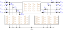

# Lines

A **line** is a multi-conductor power cable or overhead line, modeled as a nominal
$\Pi$ equivalent: a series impedance with a shunt admittance half-section at each
end.

The foundational model (data model, symbols, variables, constraints) is in the
[Line page of the BMOPF specification](https://distribution-system-opt.github.io/math-and-data-model-specifications/stable/spec/line/).
This page records where BMOPFTools extends it and how BMOPFTools implements it.
Symbols are defined in [Notation](notation.md).



## Linecode

A `linecode` stores per-meter matrices shared across lines of the same type; see
[Linecode](https://distribution-system-opt.github.io/math-and-data-model-specifications/stable/spec/line/#Linecode)
for its fields. BMOPFTools also accepts linecodes compiled from conductor geometry
(see [below](#Linecode-provenance-fields) and [Impedance derivation](impedance.md)).

## BMOPFTools extensions to the specification

### Linecode provenance fields

Besides the specification's fields (including the free-text `source` note),
BMOPFTools linecodes may carry:

| Field | Type | Description |
|-------|------|-------------|
| `line_geometry` | string | Back-reference to the `line_geometry` the linecode was compiled from |
| `derivation` | object | Provenance of the impedance computation (method, earth resistivity, frequency, temperature, reduced shields, defaults applied, tool and version) |

[`compile_linecode`](@ref) sets `source = "geometry"`, `line_geometry`, and
`derivation`; external tools (for example FEM) may fill `derivation` freely. Like
`source`, these fields are metadata only and do not change the electrical model.

### Per-line angle difference

Optional `va_diff_min`/`va_diff_max` (radians) bound the angle drop
$\theta_{i}-\theta_{j}$ along each **phase** conductor; neutral and
protective-earth conductors are exempt, since neither has an operating angle to
bound. With $\textcolor{blue}{z}=\textcolor{blue}{U_{i,\cdot}}\,(\textcolor{blue}{U_{j,\cdot}})^{*}=c+\textcolor{brown}{j}s$:

```math
\tan(\textcolor{red}{\theta^{\Delta,\min}_\ell})\, c \ \le\ s \ \le\ \tan(\textcolor{red}{\theta^{\Delta,\max}_\ell})\, c.
```

Both bounds must be supplied and lie strictly within $(-\pi/2, \pi/2)$; the rows are
scaled by $\cos$ of each bound, and an equal-endpoint window adds $c\ge 0$. Zero
voltage has no defined angle, so these rows do not imply a voltage lower bound.

## Implementation in BMOPFTools

### [Realization](@id Realisation)

- **Rectangular Ohm's law.** The complex series voltage drop is stamped as its two
  real parts per conductor $k$ ([`branch.jl:_add_line_constraints!`](https://github.com/frederikgeth/BMOPFTools.jl/blob/main/ext/BMOPFOpfExt/branch.jl)):
  $\mathfrak{R}(\textcolor{blue}{U_i})-\mathfrak{R}(\textcolor{blue}{U_j}) = \sum_{j'}(\mathbf{R}_{kj'}\mathfrak{R}(\textcolor{blue}{I^{\text{s}}})-\mathbf{X}_{kj'}\mathfrak{I}(\textcolor{blue}{I^{\text{s}}}))$
  and $\mathfrak{I}(\textcolor{blue}{U_i})-\mathfrak{I}(\textcolor{blue}{U_j}) = \sum_{j'}(\mathbf{R}_{kj'}\mathfrak{I}(\textcolor{blue}{I^{\text{s}}})+\mathbf{X}_{kj'}\mathfrak{R}(\textcolor{blue}{I^{\text{s}}}))$.
- **Shunt currents are not variables.** Where the specification writes
  $\textcolor{blue}{\mathbf{I}^{\text{sh}}}=\textcolor{brown}{\mathbf{Y}^{\text{sh}}}\textcolor{blue}{\mathbf{U}}$
  as a current, the code introduces **no** variable for it. It builds the affine JuMP
  expression $\textcolor{brown}{\mathbf{Y}^{\text{sh}}}\textcolor{blue}{\mathbf{U}}$
  ([`shunt.jl:_shunt_current!`](https://github.com/frederikgeth/BMOPFTools.jl/blob/main/ext/BMOPFOpfExt/shunt.jl)) and substitutes it **in place**
  wherever $\textcolor{blue}{\mathbf{I}^{\text{sh}}}$ appears: the KCL contribution
  and the terminal-current limit. The terminal current
  $\textcolor{blue}{\mathbf{I}_{\ell ij}}=\textcolor{blue}{\mathbf{I}^{\text{s}}_{\ell ij}}+\textcolor{brown}{\mathbf{Y}^{\text{sh}}_{\ell ij}}\textcolor{blue}{\mathbf{U}_i}$
  is thus an expression, not a variable. This is exact: it eliminates the
  shunt-current variables and their defining equalities analytically.
- **Series-current alias.** Only the from-side series current is a variable
  (`cr_fr`/`ci_fr`, [`variables.jl:_add_line_variables!`](https://github.com/frederikgeth/BMOPFTools.jl/blob/main/ext/BMOPFOpfExt/variables.jl)); the
  conservation law $\textcolor{blue}{\mathbf{I}^{\text{s}}_{\ell ji}}=-\textcolor{blue}{\mathbf{I}^{\text{s}}_{\ell ij}}$
  is applied by making the to-side an `AffExpr` alias `-cr_fr`, so it is never a
  separate variable or equality.
- **Conductor counts** of the impedance matrix and both terminal maps must match
  exactly; a mismatch is refused (`E.INT.LINE_DIM_MISMATCH`), never truncated.
- **Ratings.** `i_max` and `s_max` each follow the precedence **line override →
  linecode → unconstrained**, independently. Both are enforced natively when
  present: the current cone on the terminal current at each end (the to-end cone is
  added whenever the line has any shunt), and the ground-referenced per-conductor
  apparent-power cone at both ends. The binding one can change with voltage, so the
  pair is not mathematically redundant, but declaring both is usually an
  engineering duplication (`W.RED.DUAL_THERMAL_LIMIT`), and the neutral entry of
  `s_max` is degenerate since $U_n\approx 0$ (`W.DOM.POWER_LIMIT_NEUTRAL`). See
  [current vs. apparent-power limits](../opf.md#Current-vs-apparent-power-limits).
- **Cartesian box** is `_limit_current_box!` in `branch.jl`, applied for each end's
  shunt (the tighter box wins) and added only when every voltage cap feeding the row
  is known. The **angle** limit is `branch.jl:_add_line_angle_constraints!`.

### Source map

| Constraint | Code location |
|------------|---------------|
| Series current variable | `variables.jl:_add_line_variables!` |
| Impedance / shunt construction | `data_utils.jl:_line_z_matrix`, `_line_pi_shunt` |
| Ohm's law (rectangular) | `branch.jl:_add_line_constraints!` |
| Shunt-current expression (substituted) | `shunt.jl:_shunt_current!` |
| KCL contributions | `branch.jl:_add_line_constraints!` (`_kcl_add!`) |
| Thermal / apparent-power limits | `branch.jl:_add_line_constraints!` |
| Series-current box | `branch.jl` (`_limit_current_box!`) |
| Per-line angle limit | `branch.jl:_add_line_angle_constraints!` |
| Geometry-compiled linecodes | `src/lineconstants/compile.jl:compile_linecode` |

### Reconciliation notes (data model)

!!! warning "Angle-difference fields absent from the schema"
    `va_diff_min`/`va_diff_max` on a line are enforced by the solver but are not in
    the bundled schema's line properties (which disallow additional properties), so
    data that uses them does not validate against the schema.
