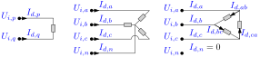

# Loads

A **load** draws a specified power at a bus. Its power may be constant, or vary with
voltage (ZIP / exponential), and it is connected single-phase, wye, or delta.
For *choosing* between the load models, and identifying one from measurements, see
the [load-model tutorial](../tutorial_load_models.md).

The foundational model (data model, symbols, variables, constraints) is in the
[Load page of the BMOPF specification](https://distribution-system-opt.github.io/math-and-data-model-specifications/stable/spec/load/).
This page records where BMOPFTools extends it and how BMOPFTools implements it.
Symbols are defined in [Notation](notation.md).

## BMOPFTools extensions to the specification

### Load-model names

BMOPFTools spells the `model` values in lowercase: `constant_power` (default),
`constant_current`, `constant_impedance`, `zip`, `exponential`. The specification's
uppercase spellings (`CONSTANT_POWER`, …) are not accepted: the OPF refuses an
unrecognized `model` value with an `ArgumentError`, and the bundled schema
enumerates only the lowercase names.

## Implementation in BMOPFTools

### [Realization](@id Realisation)

- **Rectangular bilinear power.** With $\Delta v^r,\Delta v^i$ the drop and
  `crd`/`cid` the sub-load current, the code stamps
  $P = \Delta v^r\,\text{crd} + \Delta v^i\,\text{cid}$ and
  $Q = \Delta v^i\,\text{crd} - \Delta v^r\,\text{cid}$
  ([`load.jl:_add_load_constraints!`](https://github.com/frederikgeth/BMOPFTools.jl/blob/main/ext/BMOPFOpfExt/load.jl)), then pins them per `model`
  (`_add_subload_power!`).
- **Quadratic ZIP/exponential.** A squared-voltage-drop **variable**
  $W=\Delta v^{r2}+\Delta v^{i2}$ (and, when a constant-current term is present,
  $s=\sqrt{W}$) is introduced so ZIP terms stay quadratic, when the sub-load
  has a positive lower voltage bound (see the next section for the other cases).
  Integer exponents are routed to the constant-Z/I/P terms; only a genuinely
  non-integer exponent emits the nonlinear term $\textcolor{red}{P^{\text{nom}}}(W/\textcolor{red}{V^{\text{nom}}}^2)^{\gamma/2}$.
- **`SINGLE_PHASE` two-terminal handling.** A length-2 map is treated as one element
  between the two listed terminals — phase-to-neutral *or* phase-to-phase — not as a
  phase-to-ground load, so 240 V split-phase loads are modeled correctly.
- **KCL** contributions are added at the host terminals (`_kcl_add!`); the neutral
  return is implicit as the sum of phase currents.
- **Constant-power equivalents.** A ZIP or exponential sub-load whose terms reduce
  to constant power is pinned exactly like `constant_power`, with no auxiliary
  voltage variables.

### Cartesian bounds (conditioning only)

No fixed band around $\textcolor{red}{V^{\text{nom}}}$ is imposed. The formulation
depends on what is known about the sub-load voltage:

- a pure constant-impedance sub-load uses the linear current law
  $I = \overline{S^{\text{nom}}}/\textcolor{red}{V^{\text{nom}}}^2 \cdot \Delta V$, with no $W$
  variable and no voltage bound;
- when no positive lower voltage bound applies to the sub-load's terminal pair, the law is written
  in $\ell = \log(|\Delta V|/\textcolor{red}{V^{\text{nom}}})$, which is defined for every
  positive voltage and carries no floor;
- otherwise $W$ (and $s$) are used with a lower bound at half that lower
  voltage bound. This guard stays inactive inside the permitted voltage range; it
  conditions the auxiliary variables and does not narrow the feasible set.

The operational voltage limits live on the bus, not here.

### Source map

| Constraint | Code location |
|------------|---------------|
| Load currents, KCL, per-config voltage drop | `load.jl:_add_load_constraints!` |
| Power pinning (constant / ZIP / exponential) | `load.jl:_add_subload_power!`, `_component_terms`, `_rhs_expr` |
