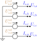

# Voltage sources

A **voltage source** is an ideal voltage reference with a free slack current. It fixes
the host-bus terminal voltages and is the power-flow reference (slack) bus. Symbols are
defined in [Notation](notation.md).

The foundational model is in the [Voltage sources page of the BMOPF specification](https://distribution-system-opt.github.io/math-and-data-model-specifications/stable/spec/source/). This page records where BMOPFTools extends it and how BMOPFTools implements it.



## BMOPFTools extensions to the specification

| Field | Type | Unit | Description |
|-------|------|:----:|-------------|
| `cost` | number[] | currency/kWh | Per-phase price of imported active power. BMOPFTools reads this field in place of the specification's `energy_cost_rate`; see [Objective](objective.md). |
| `configuration` | string | – | `"WYE"` (default) or `"SINGLE_PHASE"`; other values are rejected. |
| `p_min`, `p_max` | number[] | W | Optional per-phase active-power bounds (grid-connection limits). |
| `q_min`, `q_max` | number[] | var | Optional per-phase reactive-power bounds. |

With the bound fields absent the source is the pure slack of the specification. With
them, it becomes a bounded grid connection; see
[Optional grid-connection bounds](@ref source-grid-connection-bounds).

## Implementation in BMOPFTools

### [Realization](@id Realisation)

- **Voltage fixing.** Each phase terminal is fixed to
  `v_mag·cos(v_ang)`, `v_mag·sin(v_ang)`; the source-bus neutral is fixed to 0 V so it
  is not a free null-space variable ([`source.jl:_add_source_constraints!`](https://github.com/frederikgeth/BMOPFTools.jl/blob/main/ext/BMOPFOpfExt/source.jl)).
- **Slack current.** `cr_src`/`ci_src` are injected into KCL at the phase terminals,
  with the summed return at the neutral (`_kcl_add!`). Because the terminal voltages
  are fixed constants, the per-phase power is **linear** in the slack current.

### [Optional grid-connection bounds (implementation extension)](@id source-grid-connection-bounds)

When `p_min`/`p_max`/`q_min`/`q_max` are supplied, the per-phase power, which is
**linear** in the slack current because the terminal voltages are fixed, is
box-bounded:

```math
\textcolor{blue}{S_{s,k}} = \Delta\textcolor{blue}{U_{s,k}}\,(\textcolor{blue}{I_{s,k}})^{*} = P_k + \textcolor{brown}{j}\,Q_k,
\qquad
\textcolor{red}{P^{\min}_k}\le P_k\le\textcolor{red}{P^{\max}_k},
\qquad
\textcolor{red}{Q^{\min}_k}\le Q_k\le\textcolor{red}{Q^{\max}_k}.
```

where $\Delta\textcolor{blue}{U_{s,k}}$ is the phase-to-neutral voltage of phase
$k$ at the source bus. Absent bounds leave a pure slack.

### Source map

| Constraint | Code location |
|------------|---------------|
| Voltage fixing, neutral fixing | `source.jl:_add_source_constraints!` |
| Slack current + KCL, optional P/Q bounds | `source.jl:_add_source_constraints!` |

!!! warning "Reconciliation note — source extension fields absent from schema"
    The fields `cost`, `configuration`, `p_min`, `p_max`, `q_min`, and `q_max` are
    read and enforced by the code, but the bundled draft schema's `voltage_source`
    object lists only `v_magnitude`, `v_angle`, `bus`, `terminal_map`, and
    `time_series`. Add these fields (with units currency/kWh, W, and var) to make
    priced and bounded sources expressible in conformant data.
