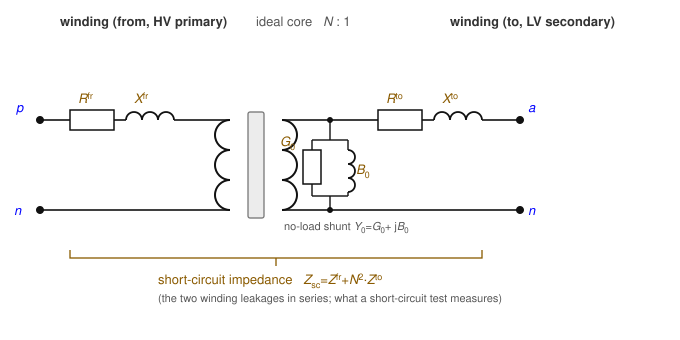
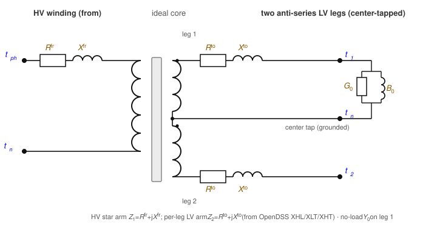
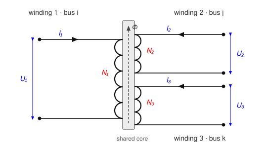

# Transformers

A **transformer** couples two buses through **galvanically isolated** windings, which
share no conductor, only magnetic flux. (Step-voltage **regulators**, where the windings
*do* share a node, are a separate element; see [Regulators](regulator.md).) Each winding
configuration is a distinct data-model object: `single_phase`, `center_tap`,
`wye_delta`, `delta_wye`, and the BMOPFTools-specific `n_winding`. Symbols are defined in
[Notation](notation.md).

The foundational model is in the [Transformers page of the BMOPF specification](https://distribution-system-opt.github.io/math-and-data-model-specifications/stable/spec/transformer/). This page records where BMOPFTools extends it and how BMOPFTools implements it; [part 6](#6.-Implementation-in-BMOPFTools) covers the implementation.

!!! note "What a “winding” counts — ports, not physical coils"
    In the literature and in tools, a **winding** (and an *n-winding* transformer)
    usually counts the number of **buses / voltage levels the transformer connects** —
    its *ports* — not the number of physical coils. For a *single-phase* transformer the
    two coincide: a two-winding single-phase unit has two coils and two ports. For a
    *three-phase* transformer they do **not**: a three-phase two-winding transformer has
    **six** physical coils (three per side) yet is still called "two-winding". Throughout
    this page "winding" means a **port** — one bus connection at one voltage
    level — and each winding comprises `n_phase` physical coils. The `n_winding` object's
    `windings` array lists these ports (each with its own `bus`), so `n` is the number of
    buses, and per phase there are `n` coils on the shared core.

## BMOPFTools extensions to the specification

The specification builds every transformer from an idealized winding pair plus a series
leakage impedance only. BMOPFTools adds:

- a **no-load (magnetizing) shunt** and **internal neutral grounding**, which with the
  series leakage form the three [loss components](#Loss-components);
- a **tap**, fixed or free (a continuous OPF variable);
- **per-winding leakage on both windings of `wye_delta`/`delta_wye`**, where the
  specification lumps a single `r_series`/`x_series` on the wye winding;
- the general **`n_winding`** subtype.

### Extension fields

| Field | Type | Unit | Description |
|-------|------|:----:|-------------|
| `r_series_from`, `x_series_from`, `r_series_to`, `x_series_to` | number | Ω | Per-winding series leakage, accepted for `wye_delta`/`delta_wye` as well. The specification's lumped `r_series`/`x_series` is migrated onto the wye winding (`r/x_series_from` for `wye_delta`, `r/x_series_to` for `delta_wye`) with the delta winding set to zero; supplying both forms for the same component is an error. |
| `g_no_load`, `b_no_load` | number | S | Legacy excitation on winding 2: bank total for single-phase/Yd/Dy, per coil for n-winding, entire first secondary half-winding for center-tap |
| `no_load_shunt` | object | S | Explicit `{winding, g, b}`, per coil of the selected winding; exclusive with the legacy fields |
| `r_neutral_from`/`_to`, `x_neutral_from`/`_to` | number | Ω | Winding-neutral grounding impedance (OpenDSS `rneut`/`xneut`) |
| `tap`, `tap_min`, `tap_max` | number | – | From-side tap multiplier; a free OPF variable when `tap_min < tap_max` |

The `n_winding` object carries a `windings` array (each with `bus`, `terminal_map`,
`v_nom`, `configuration`, `r_winding`, optional `delta_roll`, `i_max`, `s_max`) and
pairwise short-circuit reactances `x_sc` keyed `"i_j"`.

`r_winding` is an ohmic resistance at the winding's own coil voltage;
`x_sc` is in ohms referred to winding 1's coil voltage. A wye coil voltage is
line-to-neutral and a delta coil voltage is line-to-line. The engine consumes
these ohmic values directly, without using per-winding `s_rating` to rebase
them. That rating is retained metadata; explicit `s_max`/`i_max` fields declare
supported winding limits.

!!! note "Unequal winding kVAs in DSS intake"
    `from_dss` reconstructs multi-winding resistance from the source IR's `%R`,
    coil voltage, phase count, and winding-1 power base. PowerIO alone uses each
    winding's own rating, which disagrees with the independent OpenDSS primitive
    for the unequal-rating fixture. The package records changed values and source
    bases in `_meta.powerio_intake_repairs`. Smaller, equal, and larger
    winding-rating cases are regression-tested; ordinary BMOPF JSON resistances
    remain physical ohms and are not rebased.

### Extension symbols

This page writes $\textcolor{red}{U^{\text{ref}}_i},\ \textcolor{red}{U^{\text{ref}}_j}$
for the specification's $U^{\text{nom}}$ (the `v_nom_from`/`v_nom_to` fields), with turns
ratio $\textcolor{red}{N}=\textcolor{red}{U^{\text{ref}}_i}/\textcolor{red}{U^{\text{ref}}_j}$.

| Field | Symbol | Notes |
|-------|:------:|-------|
| `g/b_no_load` | $\textcolor{brown}{Y_0}=\textcolor{red}{G_0}+\textcolor{brown}{j}\textcolor{red}{B_0}$ | magnetizing shunt |
| `r/x_neutral_*` | $\textcolor{brown}{y_n}=1/(\textcolor{red}{R_n}+\textcolor{brown}{j}\textcolor{red}{X_n})$ | neutral grounding |
| `tap` | $\textcolor{red}{\tau}$ (fixed) or $\tau$ (variable) | $\textcolor{red}{N}_{\text{eff}}=\textcolor{red}{N}\,\tau$ |

When the tap is free, the ratio $\textcolor{red}{N}_{\text{eff}}$ becomes a decision
variable. The winding currents $\textcolor{blue}{I_{x,\sigma,k}}$ and winding voltages
$\textcolor{blue}{V^{\sigma}_{x,k}}$ are as in the specification's
[Variables](https://distribution-system-opt.github.io/math-and-data-model-specifications/stable/spec/transformer/#3.-Variables) section.

## 4. Equality constraints

The specification's equations hold in BMOPFTools with the turns ratio
$\textcolor{red}{N}$ replaced by the tap-adjusted $\textcolor{red}{N}_{\text{eff}}$.
The subsections below record the loss components the specification does not model
and how each subtype places them.

### [The idealized winding pair](@id The-idealised-winding-pair)

See [The idealised winding pair](https://distribution-system-opt.github.io/math-and-data-model-specifications/stable/spec/transformer/#The-idealised-winding-pair) in the
specification. With the tap, the ampere-turn balance reads
$\textcolor{red}{N}_{\text{eff}}\,\textcolor{blue}{I_{x,\text{fr}}} + \textcolor{blue}{I_{x,\text{to}}} = 0$
and, with all losses removed, $\textcolor{blue}{V^{\text{fr}}_x} = \textcolor{red}{N}_{\text{eff}}\,\textcolor{blue}{V^{\text{to}}_x}$.

### Loss components

Three loss elements dress the ideal pair. Every subtype places them the **same** way,
consistent with the OpenDSS reference model; the subtype diagrams below are the same
family of picture, differing only in how the windings connect.

- **Series leakage.** As in the specification's
  [Series leakage](https://distribution-system-opt.github.io/math-and-data-model-specifications/stable/spec/transformer/#Series-leakage) section, with the combined HV-referred
  leakage
  $\textcolor{brown}{Z_x}=\textcolor{brown}{Z^{\text{fr}}_x}+\textcolor{red}{N}_{\text{eff}}^2\,\textcolor{brown}{Z^{\text{to}}_x}$
  giving
  $\textcolor{blue}{V^{\text{fr}}_x} - \textcolor{red}{N}_{\text{eff}}\,\textcolor{blue}{V^{\text{to}}_x} = \textcolor{brown}{Z_x}\,\textcolor{blue}{I_{x,\text{fr}}}$.
- **No-load (magnetizing) shunt.** A single $\textcolor{brown}{Y_0}=\textcolor{red}{G_0}+\textcolor{brown}{j}\textcolor{red}{B_0}$
  sits across **winding 2** (the to-side coil), referred to that coil's voltage, adding
  a current $\textcolor{brown}{Y_0}\,\textcolor{blue}{V^{\text{to}}_x}$ to the to-side
  terminal. This is the core-loss/excitation branch (OpenDSS places it on winding 2,
  verified against its `Yprim`).
- **Neutral grounding.** When a wye winding's shared neutral terminal is earthed through
  an impedance, an internal branch $\textcolor{brown}{y_n}=1/(\textcolor{red}{R_n}+\textcolor{brown}{j}\textcolor{red}{X_n})$
  draws $\textcolor{brown}{y_n}\,\textcolor{blue}{U_{b,n}}$ from that neutral terminal to
  earth.

#### The loss equivalent circuit

Read on the standard per-winding-pair equivalent circuit — shown here for the archetypal
two-winding (single-phase) transformer, the reference picture every subtype below
specializes:



- **Winding series impedance** — each coil carries a series leakage,
  $\textcolor{brown}{Z^{\text{fr}}_x}=\textcolor{red}{R^{\text{fr}}_x}+\textcolor{brown}{j}\textcolor{red}{X^{\text{fr}}_x}$
  (from) and $\textcolor{brown}{Z^{\text{to}}_x}$ (to). This is the copper/leakage loss.
- **Short-circuit impedance** — a short-circuit test shorts one side and energizes the
  other, so it measures the *series sum* of the two leakages referred to one side,
  $\textcolor{brown}{Z_{\text{sc}}}=\textcolor{brown}{Z^{\text{fr}}_x}+\textcolor{red}{N}_{\text{eff}}^{2}\textcolor{brown}{Z^{\text{to}}_x}$.
  It is **not** a separate element, and the split between the two windings is a
  *modeling choice*, since the test fixes only the sum (see the note below).
- **No-load loss and magnetization** — the shunt $\textcolor{brown}{Y_0}=\textcolor{red}{G_0}+\textcolor{brown}{j}\textcolor{red}{B_0}$
  on the winding-2 coil carries the **core (no-load) loss** $\textcolor{red}{G_0}$ and the
  **magnetizing** susceptance $\textcolor{red}{B_0}$, as an open-circuit test measures.

The **optional neutral-grounding branch** $\textcolor{brown}{y_n}=1/(\textcolor{red}{R_n}+\textcolor{brown}{j}\textcolor{red}{X_n})$
(shown on the from-side neutral) is the third loss element: an internal branch from a wye
winding's neutral terminal to earth. These map one-to-one onto the data fields:
`r/x_series_from` → $\textcolor{brown}{Z^{\text{fr}}_x}$,
`r/x_series_to` → $\textcolor{brown}{Z^{\text{to}}_x}$, `g_no_load` → $\textcolor{red}{G_0}$,
`b_no_load` → $\textcolor{red}{B_0}$, `r/x_neutral_from`/`_to` → $\textcolor{brown}{y_n}$.
The subtype diagrams below omit the $\textcolor{brown}{y_n}$ branch to keep the connection
clear; it attaches to whichever winding carries a groundable neutral (`single_phase`,
`center_tap`, `wye_delta`/`delta_wye`).

!!! note "The per-winding leakage split is under-determined by a short-circuit test"
    A standard short-circuit test yields only $\textcolor{brown}{Z_{\text{sc}}}$ — the
    *sum* of the two winding leakages. Splitting it into $\textcolor{brown}{Z^{\text{fr}}_x}$
    and $\textcolor{brown}{Z^{\text{to}}_x}$ requires an extra convention (OpenDSS splits
    per its winding definitions; a common default is to put it all on one winding, i.e.
    the Γ-model with the other winding's leakage zero). The data model exposes both
    fields so the convention is explicit rather than assumed.

The subtypes below re-arrange exactly these three elements: **single-phase** is the
picture above; **center-tap** replaces the single secondary arm with two LV-leg arms;
**wye–delta / delta–wye** wrap the pair in a Δ/Y connection with a $\sqrt{3}$ referral;
and **n-winding** generalizes the two leakage arms to a star.


### Single-phase (wye–wye)

The specification's [Single-phase](https://distribution-system-opt.github.io/math-and-data-model-specifications/stable/spec/transformer/#Single-phase) equations apply with
$\textcolor{red}{N}_{\text{eff}}$ in place of $\textcolor{red}{N}$; its loss
equivalent circuit is the canonical one in
[The loss equivalent circuit](#The-loss-equivalent-circuit) above. The to-side terminal
current is $\textcolor{blue}{I_{x,\text{to},k}}+\textcolor{brown}{Y_0}\textcolor{blue}{V^{\text{to}}_{x,k}}$
(series plus magnetizing); the neutral grounding branch, if present, adds its current at
the shared neutral.

### Center-tap (split-phase)

BMOPFTools uses the specification's
[coupled-coil center-tap model](https://distribution-system-opt.github.io/math-and-data-model-specifications/stable/spec/transformer/#Center-tap-(split-phase)), with
$\textcolor{brown}{Z^{\text{fr}}_x}$ on the HV winding and
$\textcolor{brown}{Z^{\text{to}}_x}$ on each LV leg, and adds:

- the tap-adjusted ratio $\textcolor{red}{N}_{\text{eff}}$;
- the magnetizing shunt $\textcolor{brown}{Y_0}$ across winding 2, which is LV leg 1
  (between the first to terminal and the center tap);
- internal neutral grounding: `r/x_neutral_from` grounds the HV neutral and
  `r/x_neutral_to` grounds the center tap, each through $\textcolor{brown}{y_n}$.

The second leg's dot is at the center tap, so its leakage drop enters with the opposite
sign to the first leg's; giving both legs the same sign makes them identical and loses
the load-imbalance physics. As a genuine three-winding unit, the leakage is a **star**
of arms (an HV arm and one per LV leg, not a single series pair), with the no-load shunt
on leg 1:



### Wye–delta and delta–wye

BMOPFTools keeps a series leakage on **both** windings
($\textcolor{brown}{Z_{\text{wye}}}$ and $\textcolor{brown}{Z_{\text{del}}}$, from
`r/x_series_from` and `r/x_series_to` by side), where the specification's
[Wye–delta and delta–wye](https://distribution-system-opt.github.io/math-and-data-model-specifications/stable/spec/transformer/#Wye–delta-and-delta–wye) model has a lossless delta
winding. With the specification's effective ratio $\textcolor{red}{n^{\text{eff}}}$
(evaluated with $\textcolor{red}{N}_{\text{eff}}$) and, for phase $k$, cyclic partner $k'$
(next for Yd, previous for Dy), the drop on the wye phase current runs through an
effective impedance $\textcolor{brown}{Z_{\text{eff}}}$:

```math
\textcolor{blue}{U_{\text{del},k}} - \textcolor{blue}{U_{\text{del},k'}}
= \textcolor{red}{n^{\text{eff}}}\big(\textcolor{blue}{U_{\text{wye},k}} - \textcolor{blue}{U_{\text{wye},n}}\big)
- \textcolor{brown}{Z_{\text{eff}}}\,\textcolor{blue}{I_{x,\text{wye},k}},
\qquad
\textcolor{brown}{Z_{\text{eff}}}=\textcolor{red}{n^{\text{eff}}}\,\textcolor{brown}{Z_{\text{wye}}}+\frac{n_\phi}{\textcolor{red}{n^{\text{eff}}}}\,\textcolor{brown}{Z_{\text{del}}}
```

at nominal tap, with $n_\phi$ the number of phases (the factor $n_\phi$ converts the
delta impedance from the delta bus's line-to-neutral base to its line-to-line coil
base). Off-nominal taps scale the tapped-side referral exactly; see
[Realization](#Realisation). The current transform and wye star-point balance are
as in the specification. The magnetizing shunt sits across the winding-2 coils (a delta
of branches when the delta is winding 2, phase-to-neutral when the wye is winding 2);
the wye neutral may be grounded through $\textcolor{brown}{y_n}$, and a neutral
impedance on the delta side is rejected.

The same three loss elements ([The loss equivalent circuit](#The-loss-equivalent-circuit))
here wrap a delta primary and a wye secondary, with the $\sqrt{3}$ folded into the
effective ratio $\textcolor{red}{n^{\text{eff}}}$:


### General n-winding

The `n_winding` object models an arbitrary number of windings (each wye or delta) on a
shared core, from the OpenDSS-style short-circuit reactance matrix
$\textcolor{brown}{\mathbf{Z}_B}$ referred to **winding 1**. With per-winding turns
ratio $\textcolor{red}{N_k}=\textcolor{red}{U^{\text{ref}}_k}/\textcolor{red}{U^{\text{ref}}_1}$
($\textcolor{red}{N_1}=1$), referred coil currents
$\textcolor{blue}{I^{\text{r}}_k}=\textcolor{red}{N_k}\textcolor{blue}{I_k}$ and referred
coil voltages $\textcolor{blue}{V^{\text{r}}_k}=\textcolor{blue}{U_k}/\textcolor{red}{N_k}$,
per phase/leg:



```math
\sum_{k=1}^{n}\textcolor{red}{N_k}\,\textcolor{blue}{I_k} = 0,
\qquad
\textcolor{blue}{V^{\text{r}}_1} - \textcolor{blue}{V^{\text{r}}_{i+1}} = \sum_{j=1}^{n-1}\textcolor{brown}{Z_{B,ij}}\,\textcolor{blue}{I^{\text{r}}_{j+1}},\quad i=1,\ldots,n-1.
```

The coil voltage $\textcolor{blue}{U_k}$ is phase-to-neutral for a wye winding and
line-to-line for a delta winding (whose `v_nom` is the line-to-line coil voltage, so the
$\sqrt{3}$ lives in $\textcolor{red}{N_k}$). Each wye coil returns its phase currents
through its neutral; each delta coil injects between its two phase nodes. The magnetizing
shunt again sits across winding 2's coil. Taps are **not** supported for
`n_winding`: tap fields are rejected and the ratios are fixed at nominal.

This is the general form of the loss model: the leakage is a **star of per-winding arms**
(referred to winding 1) meeting at a common core node, with the no-load shunt across
winding 2's coil. It generalizes the [two-winding picture](#The-loss-equivalent-circuit) — where the
two arms in series *are* the single short-circuit impedance — to $n$ windings, where each
unordered pair $(i,j)$ has
its own short-circuit reactance $\textcolor{brown}{x_{\text{sc}}}[i,j]$ (the field `x_sc`
keyed `"i_j"`), and the star arms are recovered from that matrix
($\textcolor{brown}{x_{\text{sc}}}[i,j]=\textcolor{red}{X_i}+\textcolor{red}{X_j}$ for a
symmetric star):

![n-winding star (leakage) equivalent, referred to winding 1: each winding contributes a leakage arm to a common core node, the no-load shunt is modeled across winding 2's coil (the figure draws it at the core node), and each winding pair (i,j) has its own short-circuit reactance x_sc[i,j] = X_i + X_j.](assets/nwinding_loss.svg)

So for more than two windings there is **no single "short-circuit reactance"** — only a
matrix of pairwise short-circuits, which is exactly what the `x_sc` field records.

## 5. Inequality constraints

The two-winding subtypes use the specification's
[current circles and nameplate bound](https://distribution-system-opt.github.io/math-and-data-model-specifications/stable/spec/transformer/#5.-Inequality-constraints). The nameplate
`s_rating` cap is enforced in the power flow as well as the OPF. For `n_winding`,
`s_rating` is not enforced; instead each winding's optional scalar `i_max` caps every
phase-leg current magnitude, and its optional `s_max` caps each coil's apparent power at
`s_max / n_phase`.

## 6. Implementation in BMOPFTools

### [Realization](@id Realisation)

Each subtype's device behavior also has an exact nodal **primitive admittance**
$\textcolor{brown}{\mathbf{Y}_x}$ (`Yprim`); the closed-form matrices — the natural
artifact for cross-checking against OpenDSS or another implementation — are collected on
the [Transformer primitive admittance](transformer-admittance.md) page, and the OPF
stamps the same relations.

All transformer constraints are linear/bilinear in the voltage and current variables,
stamped in rectangular form ([`transformer.jl`](https://github.com/frederikgeth/BMOPFTools.jl/blob/main/ext/BMOPFOpfExt/transformer.jl), dispatched by
`_add_transformer_constraints!`; `nwinding.jl` for `n_winding`):

- **`single_phase`** (`_add_yy_transformer!`) — Γ-model. To keep the tap degree-2, the
  leakage is referred to the **to** side, $\textcolor{brown}{Z'}=\textcolor{brown}{Z^{\text{to}}_x}+\textcolor{brown}{Z^{\text{fr}}_x}/\textcolor{red}{N}_0^2$,
  and the drop written via $\textcolor{blue}{I_{x,\text{to}}}$ using the ampere-turn
  coupling — algebraically identical to the HV-referred $\textcolor{brown}{Z_x}$ above at
  nominal tap, matching the OpenDSS turns-scaled `Yprim`.
- **`center_tap`** (`_add_center_tap_transformer!`) — for a fixed ratio, the exact 5×5
  coupled-coil **primitive admittance** (`Yprim`) is stamped, reproducing OpenDSS to
  machine precision; for a free tap (or a zero star arm) a degree-2 **T-model** (the
  leakage star of the center-tap loss figure) is used, which is algebraically identical
  at nominal.
- **`wye_delta`/`delta_wye`** (`_add_yd_transformer!`) — the $\textcolor{red}{n^{\text{eff}}}$
  referral with the exact tap² short-circuit scaling; the effective-impedance
  coefficients are kept degree-1 in $\{\textcolor{red}{n^{\text{eff}}},1/\textcolor{red}{n^{\text{eff}}}\}$.
- **`n_winding`** (`_add_nwinding_constraints!`) — independent builder using the
  $\textcolor{brown}{\mathbf{Z}_B}$ leakage and ampere-turn relations, connection-aware
  coil incidence.
- **Neutral grounding** (`r/x_neutral_*`) and the **no-load shunt** (`g/b_no_load`) are
  stamped as extra KCL currents at the relevant terminals in every builder. An explicit
  `no_load_shunt` record is converted at parse time into a winding-connected
  [`shunt`](shunt.md); its source values are kept in
  `_meta["explicit_transformer_core_shunts"]`.
- **Continuous tap** promotes $\textcolor{red}{N}_{\text{eff}}$ (or $\textcolor{red}{n^{\text{eff}}}$)
  to a variable; an auxiliary $1/\textcolor{red}{n^{\text{eff}}}$ pinned by
  $\textcolor{red}{n^{\text{eff}}}\cdot(1/\textcolor{red}{n^{\text{eff}}})=1$ keeps the
  delta referral degree-2.

### Source map

| Subtype | Code location |
|---------|---------------|
| Dispatch | `transformer.jl:_add_transformer_constraints!` |
| single_phase (Γ) | `_add_yy_transformer!` |
| center_tap (Yprim / T-model) | `_add_center_tap_transformer!` |
| wye_delta / delta_wye | `_add_yd_transformer!` |
| n_winding (ZB leakage) | `nwinding.jl:_add_nwinding_constraints!` |

### Reconciliation notes

!!! note "Yd/Dy tap referral is exact"
    Under a non-nominal tap the short-circuit impedance referred to the tapped
    side scales as tap², matching OpenDSS; see
    [Transformer models](../transformer_models.md).

!!! warning "n-winding and loss detail beyond the specification"
    The general `n_winding` transformer, the no-load magnetizing shunt
    (`g/b_no_load`, `no_load_shunt`), internal neutral grounding (`r/x_neutral_*`),
    taps, and split Yd/Dy leakage are BMOPFTools extensions; the specification lists
    the shunt, neutral grounding, and tap-changing as not yet modeled.

!!! note "Center-tap neutral grounding"
    `single_phase` and `center_tap` share the `single_phase_or_center_tap_transformer`
    schema, which exposes `r/x_neutral_from`/`_to`. **Both builders honor them**: an
    internal $\textcolor{brown}{y_n}=1/(\textcolor{red}{R_n}+\textcolor{brown}{j}\textcolor{red}{X_n})$
    grounding branch — `*_from` grounds the HV neutral, `*_to` grounds the center-tap
    neutral. This is accepted for OpenDSS compatibility. The same grounding can be
    expressed as an explicit external [`shunt`](shunt.md) object, which an OPF test
    verifies gives identical bus voltages; the specification treats neutral grounding
    as external to the transformer.
