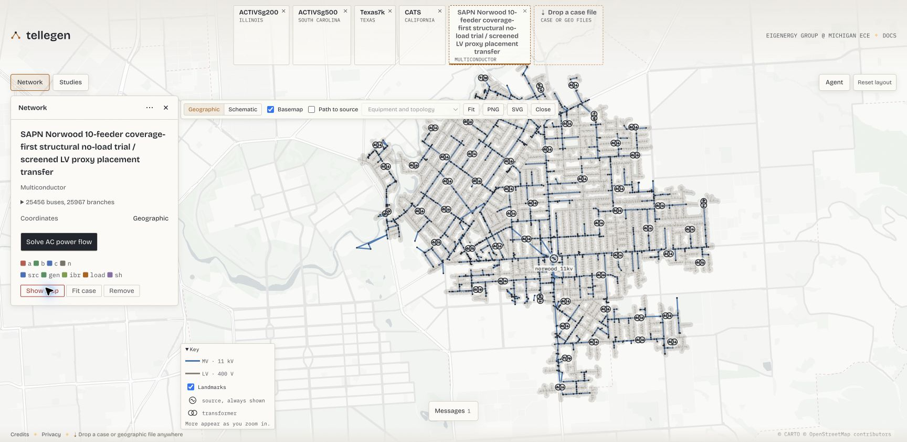
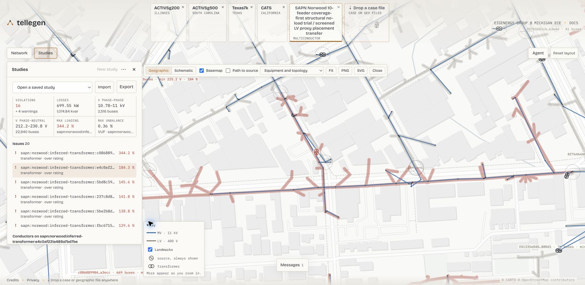
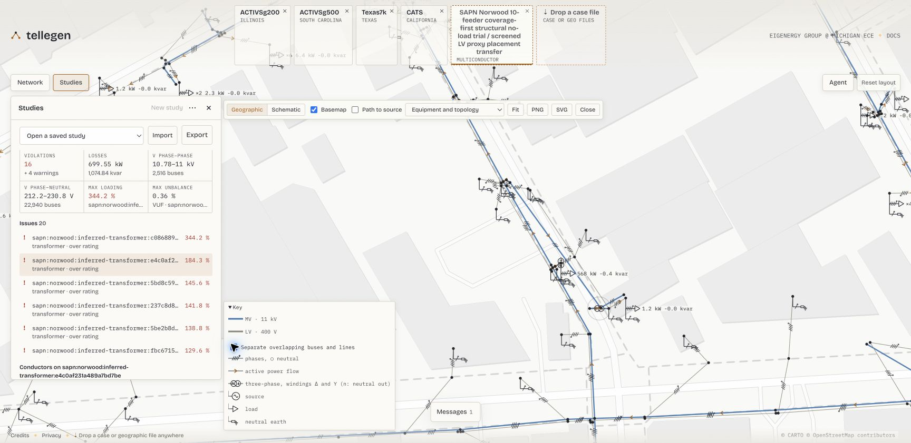
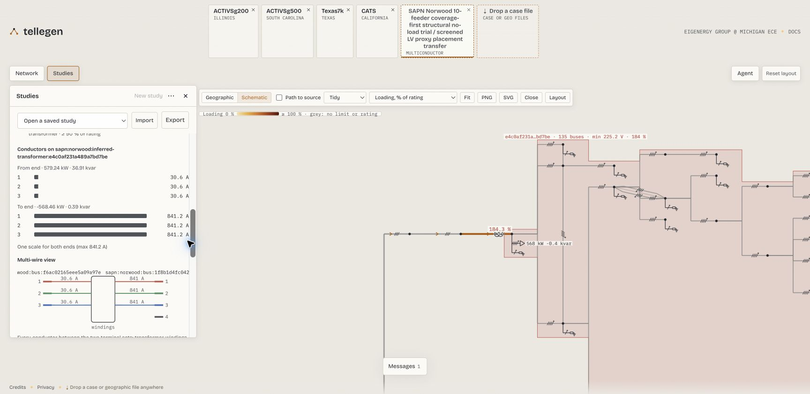

# Visualizing a case with Tellegen

**Drag and drop a BMOPF JSON file onto [Tellegen](https://tellegen.dev/) to
explore the distribution network in your browser.** Tellegen provides the
interactive viewer; BMOPFTools prepares, writes, and checks the case.
You do not need to install Tellegen or run a Julia solver to inspect a file.

[](assets/tellegen-norwood-overview.jpg)

*The public SAPN Norwood case (25,456 buses, 25,967 branches) before solving.
Blue is 11 kV, gray 400 V. Select any screenshot to open it at full resolution.*

Tellegen draws geographic and schematic single-line diagrams down to individual
terminals and conductors, and for supported models solves multiconductor power
flow with load edits re-solved in the browser. See its
[documentation](https://eigenergy.github.io/tellegen/) for current capabilities
and [Talkington et al. (2026)](@ref tellegen-paper) for the framework.

## Open your case

1. Write your network dictionary to a BMOPF **case** file:

   ```julia
   using BMOPFTools

   net = parse_bmopf("case.json")     # or net = from_dss("Master.dss")
   write_bmopf(net, "case_for_tellegen.json")
   ```

2. Open [tellegen.dev](https://tellegen.dev/) and drag
   `case_for_tellegen.json` onto the page's **drop a case file** control.
   Drop the network case, rather than a solution-only JSON or a Markdown report.
3. Choose **Show diagram** in the **Network** panel. Start with **Geographic**
   if the case has positions, or switch to **Schematic** for the engine's layout.
   If the case has no coordinates, follow the viewer's placement prompt first.
   The diagram can be opened before running power flow.

Tellegen's [local-file workflow](https://eigenergy.github.io/tellegen/local-case-files.html)
parses dropped cases locally in the browser using PowerIO and WebAssembly;
local case files are not uploaded to its solver service. The hosted site and
map resources still require network access.

## Latitude and longitude

For geographic rendering, Tellegen's PowerIO reader accepts **`latitude` and
`longitude` subfields on each bus**. For example, a bus entry can contain:

```json
{
  "terminal_names": ["1", "2", "3", "n"],
  "latitude": -27.5,
  "longitude": 153.0
}
```

Use geographic coordinates in decimal degrees from your source data.
[`write_bmopf`](@ref) **preserves these fields by default**, so existing bus
positions travel with the file you drop onto Tellegen. Coordinates are optional:
without them, the viewer can generate a topology layout for manual placement.
That layout is a drawing aid, not evidence of the network's geographic location.

[`sideload_coordinates!`](@ref) can attach positions from a headerless
`bus_id,x,y` CSV. It copies `x` to `longitude` and `y` to `latitude` without
checking or transforming the coordinate system. Use it for geographic placement
only when you know the source values are longitude/latitude; projected or
arbitrary drawing coordinates must not be relabeled as geography.
PowerIO-written cases keep their geometry in `extras.geojson`;
[`sideload_geolayer!`](@ref) applies a geographic WGS84 layer to these bus fields
and to line route geometry (see [PowerIO GeoLayer geometry](@ref)).
For companion geographic or drawing files, see Tellegen's
[display-data guide](https://eigenergy.github.io/tellegen/display-data.html).

!!! note "Strict BMOPF output"
    Bus `latitude` and `longitude` are viewer extensions outside the current
    bundled BMOPF bus schema. To omit them for a strict schema consumer, use
    `write_bmopf(net, "case_strict.json"; include_coordinates=false)`.
    This does not mutate `net`, but the omitted positions cannot be recovered
    from that file. The package's `schema_check` excludes these known extensions
    when checking the core model; it does not validate their coordinate system.

## Inspect a flagged asset

A report Finding, a spatial review item or a Tellegen issue names an asset. This
section takes one such asset from its name to its terminals and calculated
results. The screenshots use
[`norwood--p95-lv-proxy-transfer.bmopf.json`](https://github.com/frederikgeth/BMOPFDraftData/blob/d5ec79b46512a59b56157836a1ceb8459a586d04/output/SAPN/norwood--p95-lv-proxy-transfer.bmopf.json)
from the public [BMOPFDraftData SAPN set](https://github.com/frederikgeth/BMOPFDraftData/tree/d5ec79b46512a59b56157836a1ceb8459a586d04/output/SAPN),
a provisional study model with inferred equipment and proxy demand placement.
The [small feeder below](@ref "Try a small four-wire case") is enough to try the steps
without utility-derived data.

### [Find the asset by its full ID](@id 2.-Follow-an-issue-to-its-neighbourhood)

Type the asset's **full ID** into **Find a bus or branch**, for example
`sapn:norwood:inferred-transformer:e4c0af231a489a7bd7be`. The shortened label in
the drawing is only a reading aid; full IDs are what reports, review items and
result exports share.

To start from Tellegen's own issues instead, choose **Solve AC power flow** in
**Network** (or **Run power flow** in **Studies**); for cases over 25,000 buses,
choose **Analyse operating point** when prompted. Norwood's overview reports 16
violations and 4 warnings; selecting the transformer issue at **184.3%** of its
declared rating brings it into view. Zoom out a few steps for context:

[](assets/tellegen-norwood-neighbourhood.jpg)

*The red corridor marks the network with a reported problem, not every overloaded
line; the issue list names the asset that exceeded its rating.*

Color under **Equipment and topology** identifies voltage level, not voltage
compliance. **Path to source** traces a display path; in a mesh it is not how
power divides between routes.

### Read the terminal and conductor view

Zoom toward the asset until equipment symbols, phase and neutral conductor marks,
attached loads and neutral earths appear. After a solve the drawing also shows
active-power arrows and attachment P/Q values.

[](assets/tellegen-norwood-equipment.jpg)

*With **Separate overlapping buses and lines** enabled, coincident MV/LV buses
and shared routes are drawn apart; the underlying coordinates are unchanged.*

Check which terminals each load uses, whether a neutral is carried, and how
equipment connects at the bus. A neutral earth drawn through an impedance differs
from a perfectly grounded terminal; confirm the declaration in the component data.
Switch to **Schematic** (with **Loading, % of rating** under **Colour by**) to
separate electrical connection from geographic proximity; its layout comes from a
display tree and does not assert that a meshed case is radial.

### [Read the results](@id 5.-Inspect-the-evidence-behind-the-colour)

Scroll the **Studies** panel to the selected asset's conductor results. The
diagram, current bars and multi-wire view share the selection:

[](assets/tellegen-norwood-results.jpg)

*Current bars at both ends share one scale. The multi-wire view shows windings
between the terminal sets, not conductor continuity through the transformer.*

For a transformer, read the aggregate loading against its declared rating and
the connected-bus apparent power; for a bus, its terminal-pair voltages and
declared reference; for a line, currents at both ends. Result tables and CSV
exports keep full IDs and numbers. A displayed voltage range is not a compliance
check unless the case declares voltage limits (Norwood does not); the solver's
**Voltage band** status describes its load-model domain, not engineering limits.

Here the transformer is inferred equipment and its demand is proxy-allocated, so
the next step is its nameplate, demand allocation and source records — not an
edit to the case.

*Screenshots: captured 29 October 2026 from one unchanged public input; only the
overview is unsolved. Geometry: SA Power Networks via the Government of South
Australia / Location SA; model contributions CC BY-SA 4.0, subject to upstream
rights; demand proxies from SAPN aggregate telemetry and National Address
Points/G-NAF. Basemap © CARTO © OpenStreetMap contributors. No endorsement or
individual customer reconstruction is implied. Hashes, capture steps and source
notices: [screenshot provenance](assets/tellegen-norwood-attribution.txt).*

## Close the loop: diagnose, inspect, correct, recheck

The [spatial cleanup tutorial](@ref spatial-cleanup) covers analysis, the review
queue, decision records, export and replay. Tellegen fits between export and
correction:

1. Export the review bundle with [`export_spatial_review`](@ref), and write the
   case with `write_bmopf(net, "case_for_tellegen.json")`. Open `review.md`
   beside Tellegen; the file you drop onto the viewer is the BMOPF case.
2. For each review item, search its full bus and branch IDs and inspect them as
   above. Compare what you see with the item's terminal maps, voltage tiers,
   switch states, intermediate loads or grounding, and the source records.
3. Correct the responsible source data or declaration, record the decision in the
   [ledger](@ref Sidecar-dispositions), re-analyze, and reopen the revised case
   in Tellegen. For a solved result, also run [`profile_solution`](@ref) as in
   [Trust but verify](tutorial_trust_but_verify.md).

## Try a small four-wire case

This synthetic feeder has four buses, three lines and two loads, with
an explicit neutral. It has no geographic coordinates and needs only
BMOPFTools to prepare. Its illustrative electrical parameters are not calibrated
to a utility network.

```@example tellegen
using BMOPFTools

fixture = joinpath(pkgdir(BMOPFTools), "test", "data", "case_development", "feeder.json")
net = parse_bmopf(fixture)
write_bmopf(net, "tellegen-example.json")
println(length(net["bus"]), " buses, ", length(net["line"]), " lines, ",
        length(net["load"]), " loads")
```

[Download the BMOPFTools-written example](tellegen-example.json), then drag it
onto [Tellegen](https://tellegen.dev/) and follow the placement prompt.
Use the same feeder in [Developing OPF case families](tutorial_case_development.md)
to prepare different operating conditions.

## What viewing does and does not imply

Opening, drawing and solving a case in Tellegen show what the file declares; they
do not establish schema validity, electrical fidelity or solver support, and a
tidy map or a converged power flow does not validate the model. Read the viewer's
import diagnostics and calculation limitations for your case, run
[`analyze`](@ref) for the package's coded Findings, and use
[`profile_solution`](@ref) for compatible solver results.

## [Reference](@id tellegen-paper)

Samuel Talkington, Frederik Geth, Qian Zhang, Le Xie, and Skyler Liu.
*Interactive Power Flow in the Browser.* ACM DXConf 2026.
[doi:10.1145/3847238.3849038](https://doi.org/10.1145/3847238.3849038).
Preprint: [arXiv:2610.01922v1](https://arxiv.org/abs/2610.01922v1).
