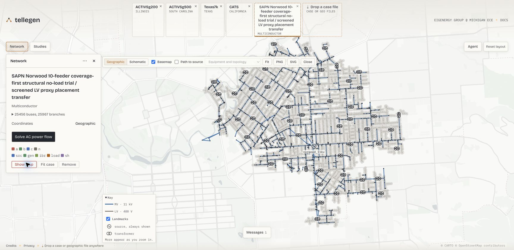
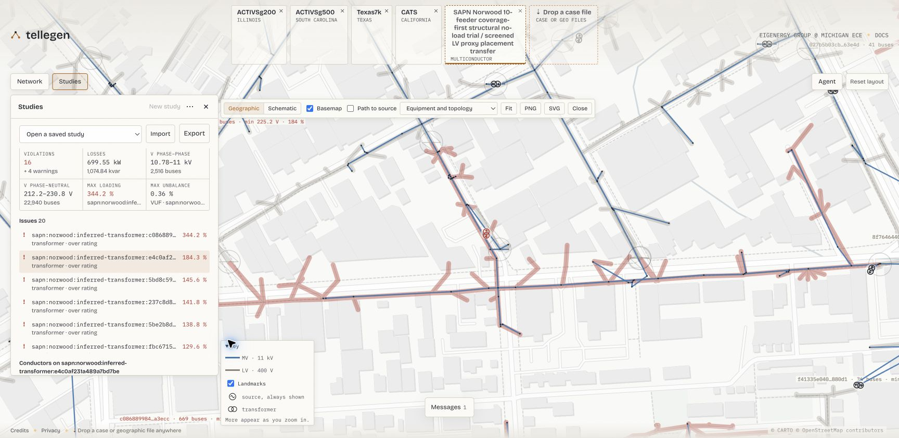
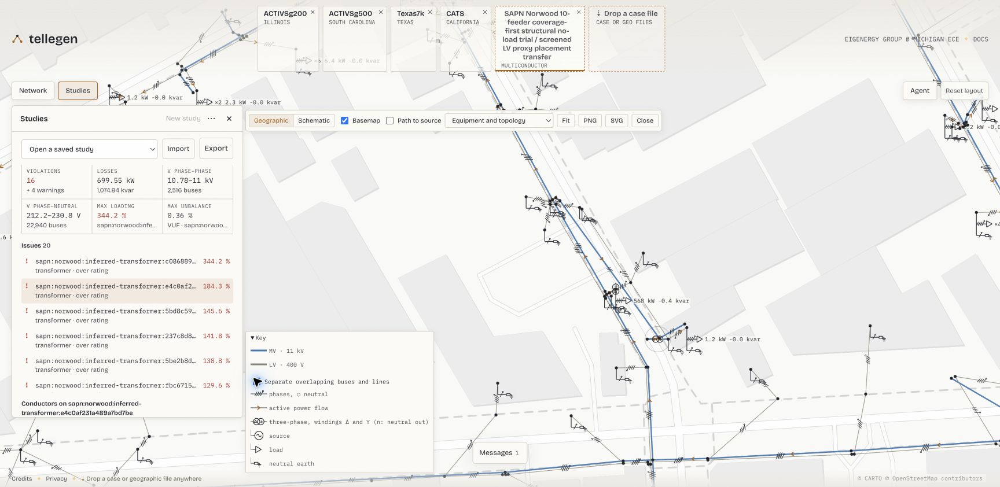
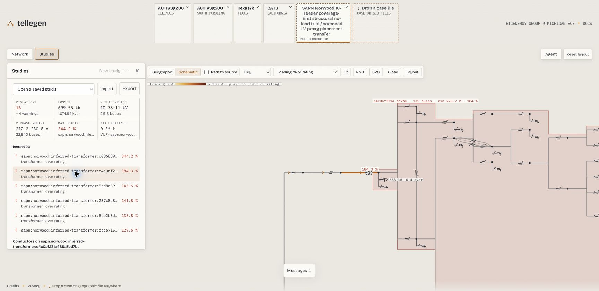
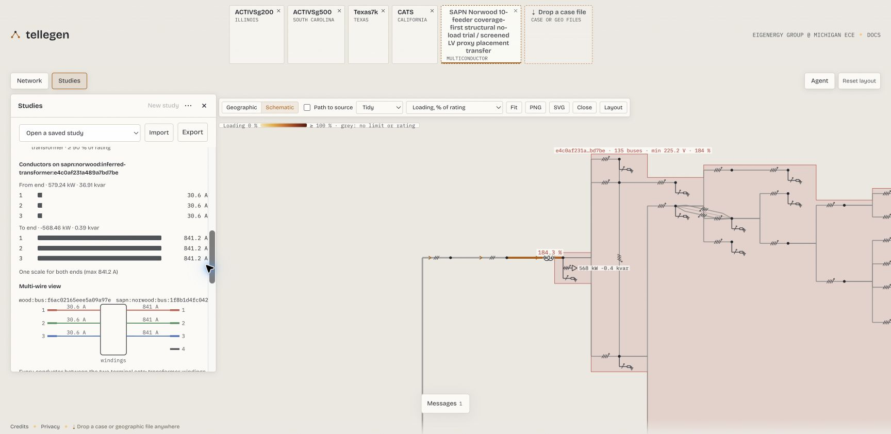

# Visualizing a case with Tellegen

**Drag and drop a BMOPF JSON file onto [Tellegen](https://tellegen.dev/) to
explore the distribution network in your browser.** Tellegen provides the
interactive viewer; BMOPFTools prepares, writes, and checks the case.
You do not need to install Tellegen or run a Julia solver to inspect a file.

[](assets/tellegen-norwood-overview.jpg)

*Start with the whole network, then zoom into its electrical connections.
This is the public SAPN Norwood case: 25,456 buses and 25,967 branches, captured
in [Tellegen](https://tellegen.dev/) on 29 October 2026 before solving.
It is a provisional study model with inferred equipment and demand placement,
not an as-operated asset register. The walkthrough below follows the same case
into a neighborhood, a transformer, and its calculated results.*

Select any screenshot to open it at full resolution.

## What Tellegen offers

- **Single-line diagrams at several scales:** switch between geographic and
  schematic layouts. Zoom from source and transformer landmarks to equipment
  symbols, conductor marks, terminal connections and, after a solve, power flows.
- **Linked inspection:** find a bus or branch, select an issue in the operating-point
  overview, and inspect the same equipment in the diagram and result tables.
- **Distribution power flow:** for supported models, calculate individual
  terminal voltages, conductor currents and source powers, with voltages relative
  to a declared neutral. Active/reactive load edits trigger fresh nonlinear
  power-flow solves using a retained numerical session.
- **Saved studies:** retain supported inputs and solved states, and export/import
  them for further exploration.
- **Transmission studies:** the wider framework also supports DC OPF, AC power
  flow, the SOCWR relaxation, and supported sensitivity previews and re-solves.
  These are separate from the multiconductor distribution workflow.

See [Talkington et al. (2026)](@ref tellegen-paper) for the framework and its
evaluation, and Tellegen's
[documentation](https://eigenergy.github.io/tellegen/) for current capabilities.

## Open your case

1. Write your network dictionary to a BMOPF **case** file:

   ```julia
   using BMOPFTools

   net = parse_bmopf("case.json")     # or net = from_dss("Master.dss")
   write_bmopf(net, "case_for_tellegen.json")
   ```

2. Open [tellegen.dev](https://tellegen.dev/) and drag
   `case_for_tellegen.json` onto the page's **drop a case file** control.
   Drop the network case, rather than a solution-only JSON or a Markdown report.
3. Choose **Show diagram** in the **Network** panel. Start with **Geographic**
   if the case has positions, or switch to **Schematic** for the engine's layout.
   If the case has no coordinates, follow the viewer's placement prompt first.
   The diagram can be opened before running power flow.

Tellegen's [local-file workflow](https://eigenergy.github.io/tellegen/local-case-files.html)
parses dropped cases locally in the browser using PowerIO and WebAssembly;
local case files are not uploaded to its solver service. The hosted site and
map resources still require network access.

## Explore a case from network to equipment

The screenshots use
[`norwood--p95-lv-proxy-transfer.bmopf.json`](https://github.com/frederikgeth/BMOPFDraftData/blob/d5ec79b46512a59b56157836a1ceb8459a586d04/output/SAPN/norwood--p95-lv-proxy-transfer.bmopf.json)
from the public [BMOPFDraftData SAPN set](https://github.com/frederikgeth/BMOPFDraftData/tree/d5ec79b46512a59b56157836a1ceb8459a586d04/output/SAPN).
Download the raw case and open it using the steps above. The large case is an
external example; the small downloadable feeder below is sufficient to try the
file workflow without obtaining utility-derived data.

The diagram and operating-point overview were introduced in
[Tellegen PR #185](https://github.com/eigenergy/tellegen/pull/185).
The views here were captured afresh from the deployed viewer. The case file is
unchanged throughout; zooming and changing layout change the drawing.

### 1. Establish the network context

At the overview scale shown at the top of this page, the key identifies
**11 kV MV** lines in blue and **400 V LV** lines in gray. Sources and transformers
remain visible as landmarks while local detail fades. Locate the supply point,
then zoom towards a transformer and the streets it supplies.

This first view answers where the study sits and how much of it you are looking
at. Color in **Equipment and topology** identifies voltage level; it is not a
voltage-compliance result. Hover a bus or line to highlight its feeder and network.
Enable **Path to source** to trace the display path upstream. In a mesh, that
navigation path is not a calculation of how power divides between routes.

### [2. Follow an issue to its neighborhood](@id 2.-Follow-an-issue-to-its-neighbourhood)

For a supported case, choose **Solve AC power flow** in **Network** (or
**Run power flow** in **Studies**). Norwood exceeds 25,000 buses, so choose
**Analyse operating point** when prompted to populate the overview.
In this capture the solve converged and the overview reported **16 violations
and 4 warnings**. These are results for the supplied provisional model.

Select the transformer ending in **`e4c0af231a489a7bd7be`** in the issue list,
shown at **184.3%** of its declared rating. The diagram brings it into view.
Zoom out a few steps to see its local network in context:

[](assets/tellegen-norwood-neighbourhood.jpg)

*The selected transformer's network runs alongside other circuits. The corridor
shows the network's reported problem state; it does not mean every line in that
corridor is overloaded. Use the issue list and the individual equipment result
to identify what exceeded its rating.*

The full transformer ID is
`sapn:norwood:inferred-transformer:e4c0af231a489a7bd7be`.
Use the full ID in **Find a bus or branch** when returning to this location;
the shortened label in the drawing is only a reading aid.

### 3. Zoom in to inspect connections

Zoom back towards the transformer, or select its issue again to bring it back
into view. Equipment symbols, phase and neutral conductor marks, attached loads,
and neutral earths become visible. After a solve, the drawing also shows active
power arrows and attachment P/Q values.

[](assets/tellegen-norwood-equipment.jpg)

*Enable **Separate overlapping buses and lines** in the key to distinguish
coincident MV/LV buses and shared routes. Their displayed separation is a drawing
aid; it does not move the underlying geographic coordinates.*

Use this scale to ask which terminals a load uses, whether a neutral is carried,
and how equipment connects at the selected bus. The single-line overview retains
conductor detail for inspection. A neutral earth drawn through an impedance is
different from a perfectly grounded terminal; use the component data and terminal
view to check the declaration.

### 4. Read the same area as a schematic

Switch to **Schematic**, then select the same issue again if the whole-case fit
makes the network too small. Select **Loading, % of rating** under **Colour by**.
The selected transformer is still the same object, now arranged by connectivity:

[](assets/tellegen-norwood-schematic.jpg)

*The schematic separates topology from map placement. The selected transformer's
network tag reports 135 buses; its 184.3% loading label directs attention to the
transformer. Gray equipment has no applicable displayed limit or rating; gray
is not a pass result.*

This view helps distinguish a connection from geographic proximity. Compare the
transformer, connected buses and downstream branches with the geographic view.
The layout is generated from a display tree; it does not assert that a meshed
case is electrically radial. Norwood's full schematic is tall and narrow, so
searching for an asset or selecting an issue is more useful than staying at fit.

### [5. Inspect the evidence behind the color](@id 5.-Inspect-the-evidence-behind-the-colour)

Scroll the **Studies** panel to the selected transformer's conductor results.
The diagram, current bars and multi-wire view share the selection:

[](assets/tellegen-norwood-results.jpg)

*The same scale is used for the current bars at both ends. The multi-wire view
shows windings between the terminal sets; it does not draw conductor continuity
through the transformer. Inspect the declared rating and connected-bus apparent
power when interpreting the aggregate loading percentage.*

For a bus, inspect its terminal-pair voltages and declared reference; for a line,
inspect currents at both ends. Use the result tables and CSV exports to retain
full asset IDs and numerical evidence. Norwood does not declare engineering
voltage limits, so its displayed voltage range is not a voltage-compliance check.
The solver's **Voltage band** status describes its load-model calculation domain,
which is separate from engineering voltage limits.

The next investigation is into the case assumptions: the selected transformer
is inferred equipment, and demand is allocated using proxies. Check its nameplate,
downstream demand allocation and source records before proposing a change. Use
BMOPFTools' analysis and review workflow below to record that evidence and recheck
an intentionally revised case. Visual inspection and solver convergence alone
do not validate the model.

### Capture provenance and reuse

The screenshots show one unchanged public input, opened through the browser's
local file picker. Only the first image is unsolved; the other four use the same
calculated operating point. Dataset hashes, capture steps, result observations
and source-specific notices are recorded in the
[screenshot provenance](assets/tellegen-norwood-attribution.txt).

Geometry: SA Power Networks, supplied through the Government of South Australia /
Location SA. Model contributions are under CC BY-SA 4.0, subject to upstream rights.
Norwood also uses SAPN aggregate telemetry
and National Address Points/G-NAF-derived demand proxies; preserve the linked
source notices. Basemap © CARTO © OpenStreetMap contributors. No endorsement or
individual customer reconstruction is implied.

## Latitude and longitude

For geographic rendering, Tellegen's PowerIO reader accepts **`latitude` and
`longitude` subfields on each bus**. For example, a bus entry can contain:

```json
{
  "terminal_names": ["1", "2", "3", "n"],
  "latitude": -27.5,
  "longitude": 153.0
}
```

Use geographic coordinates in decimal degrees from your source data.
[`write_bmopf`](@ref) **preserves these fields by default**, so existing bus
positions travel with the file you drop onto Tellegen. Coordinates are optional:
without them, the viewer can generate a topology layout for manual placement.
That layout is a drawing aid, not evidence of the network's geographic location.

[`sideload_coordinates!`](@ref) can attach positions from a headerless
`bus_id,x,y` CSV. It copies `x` to `longitude` and `y` to `latitude` without
checking or transforming the coordinate system. Use it for geographic placement
only when you know the source values are longitude/latitude; projected or
arbitrary drawing coordinates must not be relabeled as geography.
For companion geographic or drawing files, see Tellegen's
[display-data guide](https://eigenergy.github.io/tellegen/display-data.html).

!!! note "Strict BMOPF output"
    Bus `latitude` and `longitude` are viewer extensions outside the current
    bundled BMOPF bus schema. To omit them for a strict schema consumer, use
    `write_bmopf(net, "case_strict.json"; include_coordinates=false)`.
    This does not mutate `net`, but the omitted positions cannot be recovered
    from that file. The package's `schema_check` excludes these known extensions
    when checking the core model; it does not validate their coordinate system.

## Close the loop: diagnose, inspect, correct, recheck

Use Tellegen alongside [Spatial diagnostics and cleanup review](spatial_diagnostics.md)
and [Analysis & reports](analysis.md) to investigate both geographic and electrical
model errors. Spatial analysis runs by default when bus coordinate fields are
present; metric comparisons still require a supported coordinate frame and eligible
coordinates. Start with the report's coverage and applicability information.

1. **Analyze the case and export the review evidence.**

   ```julia
   using BMOPFTools

   net = parse_bmopf("case.json")
   report = analyze(net)
   render(report, "report.md")
   spatial = get(report.results[:connectivity], "spatial", nothing)
   if spatial !== nothing && haskey(spatial, "cleanup_review")
       export_spatial_review(spatial["cleanup_review"], "cleanup"; item_limit=100)
   end
   write_bmopf(net, "case_for_tellegen.json")
   ```

   The cleanup bundle includes a Markdown review, the captured queue as JSON,
   WGS84 evidence points as GeoJSON, and a decision-ledger template. Use the
   report beside Tellegen; the file to open in the viewer is the BMOPF case.

2. **Inspect the named buses and branches in Tellegen.** Use the full asset IDs
   from the report to match the evidence to the case. Inspect route-endpoint
   disagreements, unusually long spans, shared locations, and direct lines
   alongside series paths. Compare the view with terminal maps, voltage tiers,
   switch states, intermediate loads or grounding, and source records. Nearby
   buses or overlapping circuits can be intentional; appearance alone does not
   establish an incorrect connection or a duplicate asset.

3. **Correct the responsible source data or model declarations.** Establish
   whether the discrepancy comes from coordinate placement, route geometry,
   branch incidence, or electrical parameters before making a change. Keep
   physical route length separate from electrical modeling length. Record the
   evidence and rationale in a separate
   [review ledger](spatial_diagnostics.md#Sidecar-dispositions), then regenerate
   the case from the corrected source or write the revised network dictionary.

4. **Re-analyze and reopen the revised case.** Compare coordinate coverage,
   remaining spatial candidates, and electrical Findings with the earlier report,
   then inspect the revised BMOPF file in Tellegen. Revisit decisions when their
   evidence changes. For a compatible solved result, also run
   [`profile_solution`](@ref) as described in
   [Trust but verify](tutorial_trust_but_verify.md).

The spatial review identifies inspection candidates; it does not merge buses,
rewire branches, or verify a repair. A cleaner map or an empty bounded review
queue is not proof that the electrical model is correct.

## Try a small four-wire case

This original synthetic feeder has four buses, three lines and two loads, with
an explicit neutral. It has no geographic coordinates and needs only
BMOPFTools to prepare. Its illustrative electrical parameters are not calibrated
to a utility network.

```@example tellegen
using BMOPFTools

fixture = joinpath(pkgdir(BMOPFTools), "test", "data", "case_development", "feeder.json")
net = parse_bmopf(fixture)
write_bmopf(net, "tellegen-example.json")
println(length(net["bus"]), " buses, ", length(net["line"]), " lines, ",
        length(net["load"]), " loads")
```

[Download the BMOPFTools-written example](tellegen-example.json), then drag it
onto [Tellegen](https://tellegen.dev/) and follow the placement prompt.
Use the same feeder in [Developing OPF case families](tutorial_case_development.md)
to prepare different operating conditions.

## Viewing and calculation support

Opening a case is useful for inspection; it does not establish schema validity,
electrical fidelity, or solver support. Run [`analyze`](@ref) to inspect the
package's coded Findings, and use [`profile_solution`](@ref) for compatible
solver results.

Tellegen also offers [multiconductor AC power flow](https://eigenergy.github.io/tellegen/multiconductor-pf.html)
for supported equipment. This uses prescribed loads and sources; viewing a
BMOPF case does not imply support for multiconductor OPF or the transmission
demo's LMP and sensitivity controls. Read the viewer's import diagnostics and
calculation limitations for your case.

The package integration and broader fixture validation are tracked in
[issue #207](https://github.com/frederikgeth/BMOPFTools.jl/issues/207);
coordinate spaces and preservation are tracked in
[issue #254](https://github.com/frederikgeth/BMOPFTools.jl/issues/254).

## [Reference](@id tellegen-paper)

Samuel Talkington, Frederik Geth, Qian Zhang, Le Xie, and Skyler Liu.
*Interactive Power Flow in the Browser.* ACM DXConf 2026.
[doi:10.1145/3847238.3849038](https://doi.org/10.1145/3847238.3849038).
Preprint: [arXiv:2610.01922v1](https://arxiv.org/abs/2610.01922v1).
