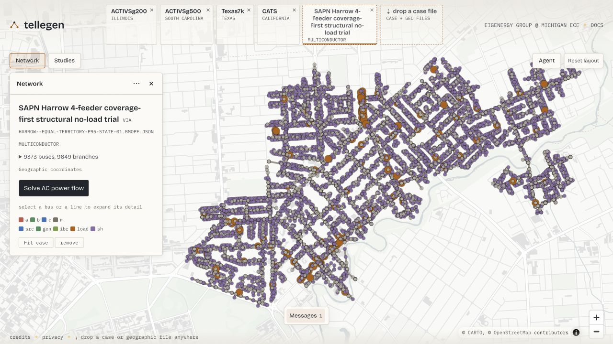

# Visualizing a case with Tellegen

**Drag and drop a BMOPF JSON file onto [Tellegen](https://tellegen.dev/) to
explore the distribution network in your browser.** Tellegen provides the
interactive viewer; BMOPFTools prepares, writes, and checks the case.
You do not need to install Tellegen or run a Julia solver to inspect a file.



*The live [Tellegen](https://tellegen.dev/) viewer, captured on 20 October 2026.
The SAPN Harrow BMOPF case from
[BMOPFDraftData](https://github.com/frederikgeth/BMOPFDraftData/tree/main/output/SAPN)
opens directly using its bus latitude/longitude fields: 9,373 buses, 9,532 lines
and 117 transformers. This is a provisional model shown for visual inspection,
not a validated operating network or a solved power-flow result. It is separate
from the downloadable four-bus example below.*

Network-model contributions: © 2026 Energex Network Model contributors
([CC BY-SA 4.0](https://creativecommons.org/licenses/by-sa/4.0/)). Geometry:
SA Power Networks, supplied by the Government of South Australia through
Location SA; no endorsement is implied. Basemap: CARTO / OpenStreetMap
contributors. See the [screenshot source and attribution](assets/tellegen-distribution-attribution.txt).

## What Tellegen offers

- **Interactive inspection:** explore network topology, select equipment, and
  inspect bus, line, load and transformer attributes with terminal detail.
- **Distribution power flow:** for supported models, calculate individual
  terminal voltages, conductor currents and source powers, with voltages relative
  to a declared neutral. Active/reactive load edits trigger fresh nonlinear
  power-flow solves using a retained numerical session.
- **Saved studies:** retain supported inputs and solved states, and export/import
  them for further exploration.
- **Transmission studies:** the wider framework also supports DC OPF, AC power
  flow, the SOCWR relaxation, and supported sensitivity previews and re-solves.
  These are separate from the multiconductor distribution workflow.

See [Talkington et al. (2026)](@ref tellegen-paper) for the framework and its
evaluation, and Tellegen's
[documentation](https://eigenergy.github.io/tellegen/) for current capabilities.

## Open your case

1. Write your network dictionary to a BMOPF **case** file:

   ```julia
   using BMOPFTools

   net = parse_bmopf("case.json")     # or net = from_dss("Master.dss")
   write_bmopf(net, "case_for_tellegen.json")
   ```

2. Open [tellegen.dev](https://tellegen.dev/) and drag
   `case_for_tellegen.json` onto the page's **drop a case file** control.
   Drop the network case, rather than a solution-only JSON or a Markdown report.
3. Inspect the network and select a bus to explore its equipment and terminal
   detail. If the case has no coordinates, follow the viewer's placement prompt
   to place its topology layout.

Tellegen's [local-file workflow](https://eigenergy.github.io/tellegen/local-case-files.html)
parses dropped cases locally in the browser using PowerIO and WebAssembly;
local case files are not uploaded to its solver service. The hosted site and
map resources still require network access.

## Latitude and longitude

For geographic rendering, Tellegen's PowerIO reader accepts **`latitude` and
`longitude` subfields on each bus**. For example, a bus entry can contain:

```json
{
  "terminal_names": ["1", "2", "3", "n"],
  "latitude": -27.5,
  "longitude": 153.0
}
```

Use geographic coordinates in decimal degrees from your source data.
[`write_bmopf`](@ref) **preserves these fields by default**, so existing bus
positions travel with the file you drop onto Tellegen. Coordinates are optional:
without them, the viewer can generate a topology layout for manual placement.
That layout is a drawing aid, not evidence of the network's geographic location.

[`sideload_coordinates!`](@ref) can attach positions from a headerless
`bus_id,x,y` CSV. It copies `x` to `longitude` and `y` to `latitude` without
checking or transforming the coordinate system. Use it for geographic placement
only when you know the source values are longitude/latitude; projected or
arbitrary drawing coordinates must not be relabelled as geography.
For companion geographic or drawing files, see Tellegen's
[display-data guide](https://eigenergy.github.io/tellegen/display-data.html).

!!! note "Strict BMOPF output"
    Bus `latitude` and `longitude` are viewer extensions outside the current
    bundled BMOPF bus schema. To omit them for a strict schema consumer, use
    `write_bmopf(net, "case_strict.json"; include_coordinates=false)`.
    This does not mutate `net`, but the omitted positions cannot be recovered
    from that file. The package's `schema_check` excludes these known extensions
    when checking the core model; it does not validate their coordinate system.

## Try a small four-wire case

This original synthetic feeder has four buses, three lines and two loads, with
an explicit neutral. It has no geographic coordinates and needs only
BMOPFTools to prepare. Its illustrative electrical parameters are not calibrated
to a utility network.

```@example tellegen
using BMOPFTools

fixture = joinpath(pkgdir(BMOPFTools), "test", "data", "case_development", "feeder.json")
net = parse_bmopf(fixture)
write_bmopf(net, "tellegen-example.json")
println(length(net["bus"]), " buses, ", length(net["line"]), " lines, ",
        length(net["load"]), " loads")
```

[Download the BMOPFTools-written example](tellegen-example.json), then drag it
onto [Tellegen](https://tellegen.dev/) and follow the placement prompt.
Use the same feeder in [Developing OPF case families](tutorial_case_development.md)
to prepare different operating conditions.

## Viewing and calculation support

Opening a case is useful for inspection; it does not establish schema validity,
electrical fidelity, or solver support. Run [`analyze`](@ref) to inspect the
package's coded Findings, and use [`profile_solution`](@ref) for compatible
solver results.

Tellegen also offers [multiconductor AC power flow](https://eigenergy.github.io/tellegen/multiconductor-pf.html)
for supported equipment. This uses prescribed loads and sources; viewing a
BMOPF case does not imply support for multiconductor OPF or the transmission
demo's LMP and sensitivity controls. Read the viewer's import diagnostics and
calculation limitations for your case.

The package integration and broader fixture validation are tracked in
[issue #207](https://github.com/frederikgeth/BMOPFTools.jl/issues/207);
coordinate spaces and preservation are tracked in
[issue #254](https://github.com/frederikgeth/BMOPFTools.jl/issues/254).

## [Reference](@id tellegen-paper)

Samuel Talkington, Frederik Geth, Qian Zhang, Le Xie, and Skyler Liu.
*Interactive Power Flow in the Browser.* ACM DXConf 2026.
[doi:10.1145/3847238.3849038](https://doi.org/10.1145/3847238.3849038).
Preprint: [arXiv:2610.01922v1](https://arxiv.org/abs/2610.01922v1).
